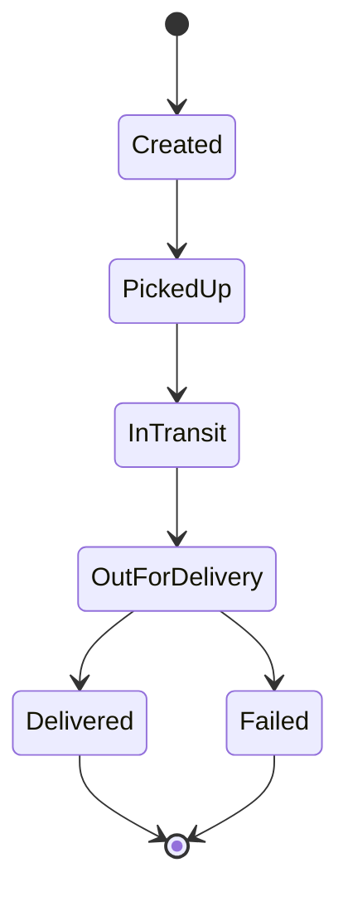

# ApexPost tracking API

`ApexPost.Api` (Week 4, Part B) exposes tracked shipments and their courier scans over REST. It reuses the Week 3 SQL Server database and data layer through dependency injection. Every request in this file is in [`src/ApexPost.Api/ApexPost.Api.http`](src/ApexPost.Api/ApexPost.Api.http), with one success and at least one failure per endpoint.

```powershell
dotnet ef database update --project src/ApexPost.Infrastructure      # adds the TrackedShipments and TrackingScans tables
dotnet run --project src/ApexPost.Api --launch-profile http          # http://localhost:5245 (https profile: https://localhost:7245)
```

The API reads the same `ConnectionStrings:ApexPostDb` user-secret as ApexPost.Web, so no extra setup is needed. Part C adds versioning (`/api/v1`, `/api/v2`) and OpenAPI; Part D adds authentication.

## Endpoints

`{trackingNumber}` is `APX-` followed by eight digits, in any letter case. Anything else does not match the route (404), so a malformed value never reaches an action.

| Verb | Route | Success | Errors | Description |
|---|---|---|---|---|
| GET | `/api/shipments?page=&pageSize=&status=&city=` | **200** a page | 400 bad page, page size, status or city | Paged list ordered by tracking number. `page` defaults to 1 and `pageSize` to 20 (maximum 50). `status` is a name or number. `city` ignores case. |
| GET | `/api/shipments/{trackingNumber}` | **200** the shipment | 404 unknown | One shipment |
| POST | `/api/shipments` | **201** the shipment, `Location: /api/shipments/{trackingNumber}` | 400 invalid body; **409** tracking number in use; 415 not JSON | Creates a shipment in status Created |
| PUT | `/api/shipments/{trackingNumber}` | **200** the shipment | 400; 404; **409** shipment Delivered or Failed; 415 | Replaces the recipient and weight; every field is sent |
| PATCH | `/api/shipments/{trackingNumber}/status` | **200** the shipment | 400 unknown status; 404; **409** not the next status; 415 | Changes the status only |
| DELETE | `/api/shipments/{trackingNumber}` | **204** no body | 404; **409** not in Created status | Deletes a shipment no courier has handled yet |
| POST | `/api/shipments/{trackingNumber}/scans` | **200** the upload result | 400 malformed scans; 404; **409** a parallel upload won (send again); 415 | Bulk upload of a courier's offline scans (Part A); idempotent |
| GET | `/api/shipments/{trackingNumber}/scans` | **200** the scans, oldest first | 404 unknown | Scan history |

Any endpoint can also return **500** for a failure that is not the caller's (see [Errors](#errors)). A route that does not exist is a 404, and a wrong method a 405.

### Status codes

| Code | When |
|---|---|
| 200 OK | A successful read, update, status change or scan upload |
| 201 Created | A shipment was created; `Location` gives its URL (`CreatedAtAction`) |
| 204 No Content | A shipment was deleted |
| 400 Bad Request | Validation failure: `ValidationProblemDetails`, with errors keyed by the JSON field |
| 404 Not Found | Unknown tracking number, malformed tracking number, unknown route |
| 405 Method Not Allowed | A known route with a verb it does not support, for example `DELETE /api/shipments` |
| 409 Conflict | Duplicate tracking number; a status move that is not allowed; deleting a shipment that is not Created; changing a finished shipment; a concurrent change won |
| 415 Unsupported Media Type | A body that is not `application/json` |
| 500 Internal Server Error | Any unexpected failure, through the global exception handler |

No error is ever returned with 200.

## Status rules



- **PATCH** moves only to the next status. Anything else is a 409 that names the allowed next status, for example *"A shipment cannot move from Created to Delivered. The next status can only be PickedUp."*
- **PUT** works until the shipment is Delivered or Failed.
- **DELETE** works only while the shipment is Created; after that, couriers' scans refer to it.

All three rules are in the domain (`TrackedShipment`, `TrackingStatusRules`) and the service, never in a controller.

## Requests and validation

The request DTOs are `CreateShipmentRequest`, `UpdateShipmentRequest`, `UpdateStatusRequest` and `ScanUploadRequest`. None is ever bound to an EF entity. `[ApiController]` validates them before the action runs. A failure is a 400 `ValidationProblemDetails` whose keys and messages use the JSON names, for example `"weightKg": ["weightKg must be between 0.1 and 70 kg."]` or `"scans[1].scannedAtUtc"`.

| Field | Rule |
|---|---|
| `trackingNumber` | Required; matches `^APX-\d{8}$` with ASCII digits (`.NET`'s `\d` would also accept other scripts' digits) |
| `weightKg` | Required; 0.1 to 70 |
| `recipientName`, `recipientAddress`, `city` | Required, not blank; at most 100, 200 and 80 characters |
| `recipientPhone` | Required; **custom `[PhoneNumber]`**: 7 to 15 digits, with an optional leading `+`, spaces, hyphens and brackets. It is the domain's own rule, so the two cannot disagree. |
| `status` | Required; a known status, by name (`"PickedUp"`) or number (`1`) |
| `scans` | 1 to 100 scans. **Custom `IValidatableObject`**: a scan ID appears only once per upload. |
| `scans[i].scanId` | Required; `scan::` followed by a GUID, the ID the courier's device gave the scan |
| `scans[i].scanType` | Required; `Pickup`, `InTransit`, `Delivered` or `Failed` |
| `scans[i].location`, `courierId`, `notes` | Location and courier required; at most 100, 32 and 500 characters |
| `scans[i].scannedAtUtc` | Required; **custom `[NotInFuture]`**: at most 5 minutes ahead of the server clock, to allow for phone clock drift |

A body that is not valid JSON, or a value of the wrong type, is reported against its JSON path as `"$.status": ["The input was not valid."]`. The serializer's own message is not returned, because it names internal types.

## Errors

Every error response is **ProblemDetails** (`application/problem+json`), with `type`, `title`, `status`, `instance` (the method and path) and `traceId`:

```json
{
  "type": "https://tools.ietf.org/html/rfc9110#section-15.5.10",
  "title": "The request conflicts with the current data.",
  "status": 409,
  "detail": "Only a shipment in Created status can be deleted; this one is InTransit.",
  "instance": "DELETE /api/shipments/APX-24100001",
  "traceId": "00-7c94b1f1a3049f36ed6f8c4be0ebce36-61cfbb396044b0dc-00"
}
```

- **`ApiExceptionHandler`** is the global `IExceptionHandler`. It decides **by exception type only**:
  - the service's `RequestValidationException` becomes 400;
  - a `NotFoundException` becomes 404;
  - a `ConflictException` becomes 409. This includes the unit of work's duplicate-key and concurrency conflicts.

  The messages of these types are written for the caller and are returned in every environment.
- **Anything else is a 500.** That includes an `ArgumentException` thrown by a library: a bug or an outage, not a bad request.
  - The 500 is logged with its stack trace.
  - Outside Development the response says only *"An unexpected server error occurred."* and asks the caller to quote the `traceId`.
  - Only in Development does it add an `exception` member with the type, message and stack trace.
- **Errors with no body** (an unmatched route, a wrong method, a wrong content type) get a ProblemDetails body from `UseStatusCodePages`.

This differs from Week 3's web application, which reads stack traces to tell a domain `ArgumentException` from a framework one ([ADR 0018](docs/adr/0018-exceptions-to-problem-details-status-codes.md)). The tracking service converts input errors into the typed `RequestValidationException` itself, so the API needs no such heuristic ([ADR 0026](docs/adr/0026-api-errors-by-exception-type.md)).

## Idempotent scan upload

A courier's device saves scans offline with its own IDs (`scan::{Guid}`, Part A), then uploads them for one shipment:

```json
POST /api/shipments/APX-24100001/scans
{ "scans": [ { "scanId": "scan::0199a001-0000-7000-8000-000000000001", "scanType": "Pickup",
               "location": "Riverside Depot", "courierId": "CR-001", "scannedAtUtc": "2026-11-01T08:00:00Z" } ] }
```

```json
200 OK
{ "accepted": 2, "duplicatesSkipped": 0, "rejected": 1,
  "rejections": [ { "scanId": "scan::0199a001-0000-7000-8000-000000000003",
                    "reason": "A Delivered scan cannot be recorded: a shipment cannot move from InTransit to Delivered; the next status can only be OutForDelivery." } ],
  "shipmentStatus": 2 }
```

Each scan is counted exactly once:
- **Duplicate.** The scan ID is already stored for this shipment. Re-sending an upload (after a timeout or a lost response) stores nothing twice; it only reports the scans again as `duplicatesSkipped`.
- **Accepted.** New scans are applied **oldest first**, so a pickup and a later in-transit scan sent together move the shipment in the order they happened. A scan for the next status moves the shipment. A repeat (a second hub's InTransit) or a late scan for a stage already passed is kept as history, and the status never goes backwards.
- **Rejected,** with the reason. Nothing is stored for it. This covers:
  - a scan the status rules refuse;
  - a scan ID already used for a *different* shipment. The reason does not name that shipment, so scan IDs cannot be used to discover tracking numbers.

The device marks accepted and duplicate scans **Synced**, and only the listed rejections **Failed**. A rejected scan may be sent again later: a Delivered scan is accepted once the shipment is OutForDelivery.

**Consistency.** Everything accepted is saved in **one commit**. Two uploads of the same shipment at the same time cannot both save:
- the scan ID is a unique key (`AK_TrackingScans_ScanId`);
- the shipment row has a `rowversion`.

The loser gets a **409** saying *"Send the upload again"*, and the retry reports the winner's scans as duplicates. In 30 rounds of two parallel identical uploads against SQL Server, every round gave one 200 and one 409, and no scan was ever stored twice.

**Whole-request failures.** A malformed scan, or a scan time in the future, fails the whole request with a 400 that names it, for example `scans[2].scannedAtUtc`. That is a client defect rather than a business decision, and the key tells the device which scan to fix.

## Design notes

- **Thin controllers.** `ShipmentsController` and `ScansController` bind the request, call `ShipmentTrackingService` once and return `Ok`, `CreatedAtAction` or `NoContent`. They catch nothing. A test checks that the service is their only dependency.
- **Separate tracking model.** `TrackedShipment` is separate from the counter's Week 3 `Shipment`, which is priced and billed at a branch, has no recipient or status, and caps weight at 30 kg. The migration `AddShipmentTracking` only adds tables ([ADR 0025](docs/adr/0025-tracked-shipments-beside-counter-shipments.md)).
- **Audit and least privilege.** API changes are recorded in the Week 3 `DataChanges` history, with the request's trace ID as the correlation ID. [`database/security/apexpost-api-role.sql`](database/security/apexpost-api-role.sql) is the API's least-privilege role: the two tracking tables and the audit table only.
- **Enums are written as numbers** (`"status": 1`), and accepted as names or numbers. Part C's v2 changes the response to names, which is a breaking change, so it needs a new version.
- **Fictional data only.** No secret is in a committed file.
