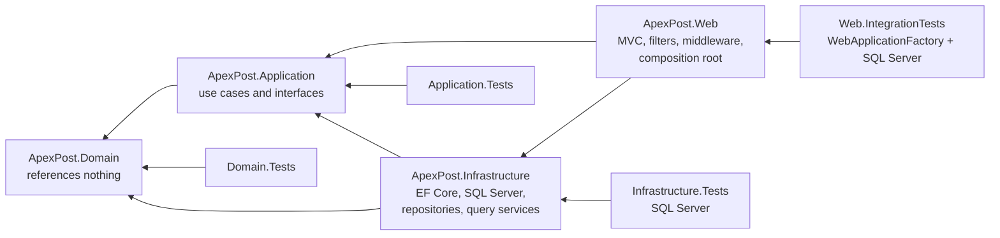
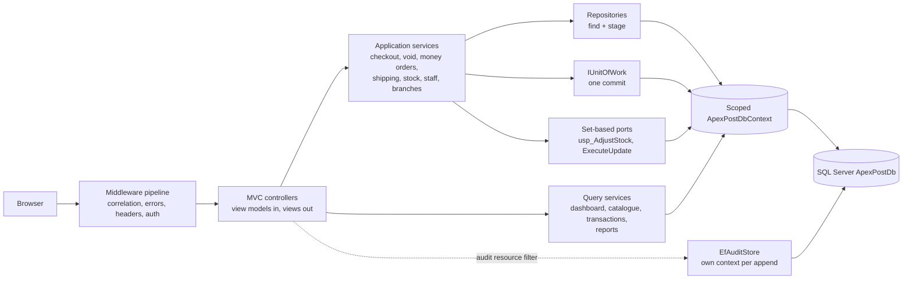
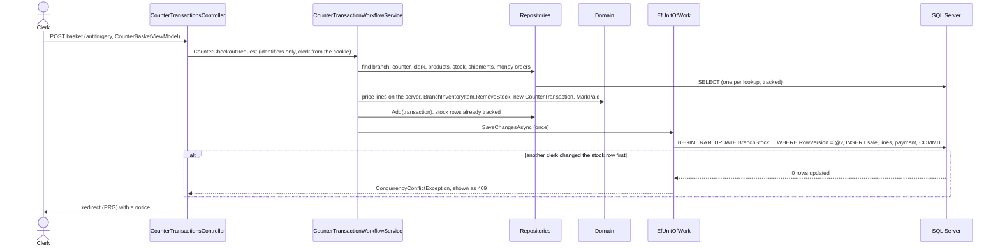
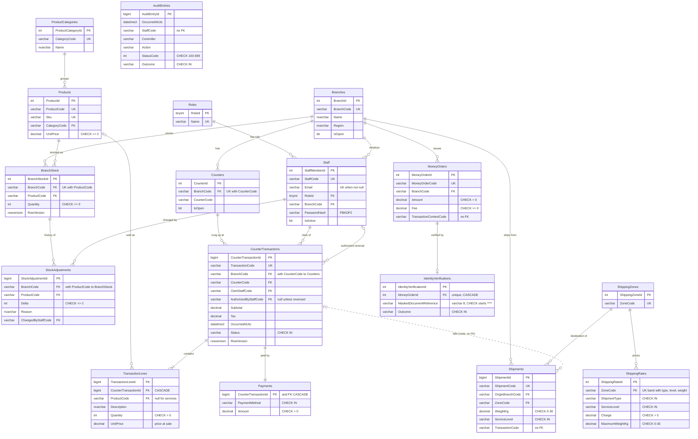
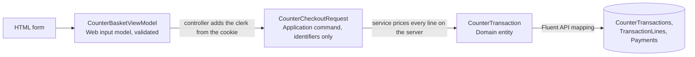
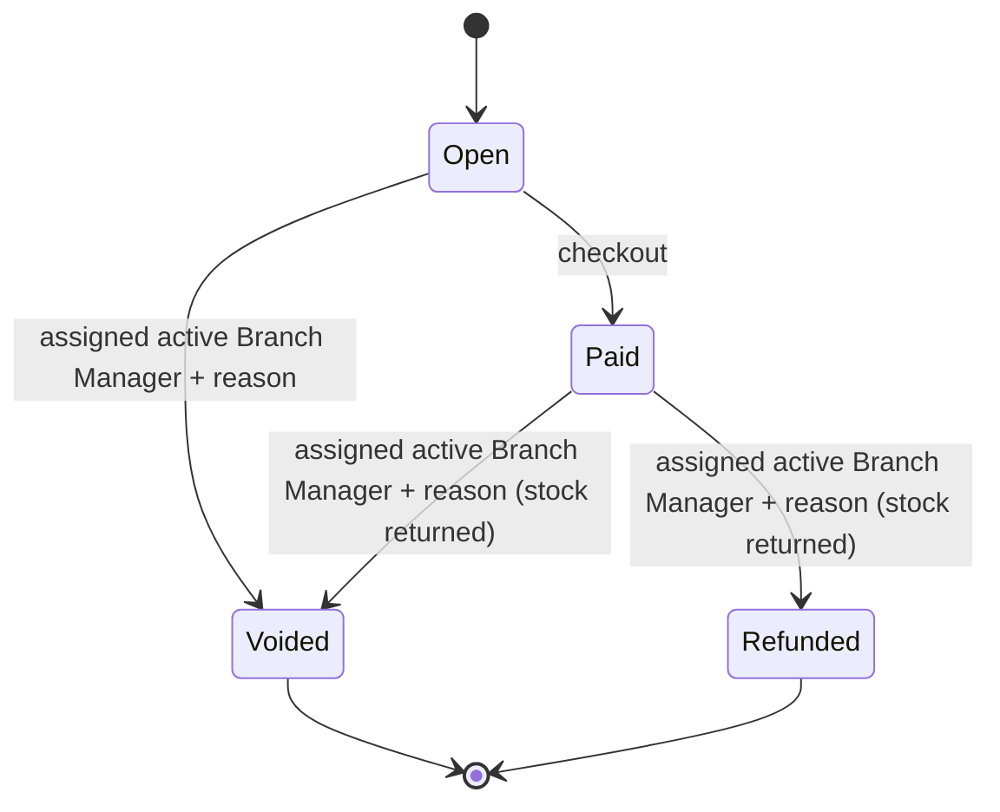
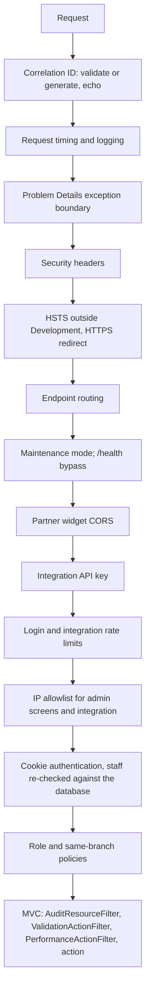

# ApexPost Logistics: design

ApexPost is an ASP.NET Core MVC application for post-office counters: retail sales, shipments, money orders with identity verification, voids and refunds, stock, and branch reports. Since Week 3, **Microsoft SQL Server is the system of record**, accessed through **EF Core 10**. The domain rules and the application interfaces are the ones Week 2 built; only the persistence behind them changed, and the Week 2 domain tests still pass unchanged.

| | Week 2 | Week 3 |
|---|---|---|
| Storage | JSON files under `App_Data` | SQL Server `ApexPostDb`, 17 tables, code-first migrations |
| Writes | Each repository saved its own file | Repositories stage; one unit of work commits once per use case |
| Concurrency | Per-file and per-branch `SemaphoreSlim`, compensating writes | `rowversion` optimistic concurrency, database transactions (ADR 0017) |
| Reads | Repositories loaded aggregates; reports summed in memory | Query services with no-tracking projections, and three stored procedures |
| Audit | JSON Lines file | `AuditEntries` table, written outside the unit of work (ADR 0011) |
| Errors | Generic 500 | 409 / 404 / 400 / 500 Problem Details (ADR 0018) |

Related documents:
- [README](README.md): setup, running, demo accounts.
- [PERFORMANCE.md](PERFORMANCE.md): indexes and execution plans.
- [sql/README.md](sql/README.md): reporting queries, T-SQL transactions, blocking and deadlocks.
- [docs/security.md](docs/security.md), [docs/testing.md](docs/testing.md), [docs/business-rules.md](docs/business-rules.md).

## Architecture

### Projects and dependencies

| Project | Owns | References |
|---|---|---|
| `ApexPost.Domain` | Entities, value objects, enums, business invariants | Nothing |
| `ApexPost.Application` | Use-case services, policies, repository / unit-of-work / query / audit interfaces, read models, application exceptions | Domain |
| `ApexPost.Infrastructure` | EF Core `ApexPostDbContext`, configurations, migrations, repositories, unit of work, query services, stored procedure scripts and callers, audit store, seeding | Application, Domain, EF Core |
| `ApexPost.Web` | MVC controllers, views, view models, filters, middleware, authentication, **composition root** (`Program.cs`) | Application, Infrastructure |

The dependencies point inward:
- **Domain** has no project references and no EF Core attribute.
- **Application** defines every interface it needs (repositories, `IUnitOfWork`, query services, `IAuditStore`, `IStockAdjustments`, `ICatalogueBulkUpdates`) and does not know EF Core.
- **Infrastructure** implements those interfaces.
- **Web** wires everything together in `Program.cs` and holds no business rule.

### Components at run time

### A write, end to end (checkout)

## Data model

### ER diagram

**Columns every table has (left out of the diagram):**
- `CreatedAtUtc` (`DEFAULT SYSUTCDATETIME()`), `CreatedBy` (`DEFAULT 'system'`) and `ModifiedAtUtc`, stamped by `AuditColumnsInterceptor` from the signed-in staff member.
- Money is `decimal(18,2)`, points in time are UTC `datetime2(3)`, codes are `varchar`, names are `nvarchar`.

**Constraints and delete behaviours:**
- The keys, the 26 CHECK constraints and every delete behaviour are explained in [ADR 0013](docs/adr/0013-schema-design-and-delete-behaviours.md).
- In short, only a sale's lines and payment, and a money order's verification, cascade. Everything else is `NO ACTION`, because history must not disappear with its branch, product or staff member.

**Schema script:** the generated script is [`database/ApexPostDb.idempotent.sql`](database/ApexPostDb.idempotent.sql) (`dotnet ef migrations script --idempotent`).

### Normalisation: three anomalies the design prevents

The tables are in third normal form. Each fact is stored once, in the table whose key it depends on. That design prevents these anomalies:

1. **Update anomaly (prevented by 3NF, no transitive dependency).**
   - A staff member's role name depends on the role, not on the staff member. `Staff` therefore holds only `RoleId`, and the name lives once in `Roles`.
   - Likewise, a category's name lives once in `ProductCategories`, and a branch's name and region once in `Branches`.
   - Renaming a role, category or branch changes one row. With the name copied into every staff, product or sale row, a rename that missed some rows would leave the database contradicting itself.
2. **Insertion anomaly (prevented by keeping independent facts in their own tables).**
   - Zones and their rates are their own tables, so a new destination zone and its prices can be set up before the first parcel goes there.
   - A product exists in `Products` before any branch stocks it.
   - If rates were stored on shipments, or products only as stock rows, they could not be recorded until their first use.
3. **Deletion anomaly (prevented by 2NF, no partial dependency).**
   - `BranchStock` is keyed by `(BranchCode, ProductCode)` and holds only what depends on that pair: the quantity. The product's SKU, name, category and price depend on the product alone, so they live in `Products`.
   - Removing a branch's last stock row for a product therefore cannot remove the product from the catalogue.

**Two copies are deliberate**, because they are historical facts rather than repeated reference data:
- **`TransactionLines.UnitPrice` and `Description`** are what the customer was charged. A later catalogue price change must not rewrite past receipts.
- **The sale's `Subtotal` and `Tax`** are fixed at payment.

## Persistence with EF Core 10

### Mapping

- **`ApexPostDbContext`** has one `DbSet` per aggregate root. It applies one `IEntityTypeConfiguration` class per entity (`Persistence/Configurations`), using the Fluent API only.
- **Domain entities are mapped directly** ([ADR 0016](docs/adr/0016-domain-and-persistence-model-separation.md)):
  - **Value converters** for the codes, `Money`, `Sku` and `ParcelWeight`, and `DateTimeOffset` → UTC.
  - **Owned types:** `ParcelDimensions` in the shipment row; `TransactionLines` and `Payments` in their own tables.
  - **A complex property** for `Product.UnitPrice`, so it can be updated with `ExecuteUpdateAsync`.
  - **Shadow properties** for the surrogate keys, the `RowVersion` columns and the audit columns.
  - **Private constructors** so EF Core can materialise the entities.
- **Money orders have their own persistence model.** `MoneyOrderEntity` and `IdentityVerificationEntity`, with `MoneyOrderMapper`, make sure only a masked document reference can be stored or read back.
- **`AuditColumnsInterceptor`** stamps `CreatedAtUtc`, `CreatedBy` and `ModifiedAtUtc` on every `SaveChanges`, using `ICurrentStaffContext`.

### Migrations

| Migration | Contents |
|---|---|
| `InitialCreate` | 17 tables, keys, alternate keys, CHECK and DEFAULT constraints, FK indexes; roles and the `GENERAL` category seeded with `HasData` |
| `AddStoredProcedures` | Deploys the three `CREATE OR ALTER` procedures, with the text they shipped kept in the migration ([ADR 0012](docs/adr/0012-stored-procedures-for-reports-and-stock-adjustment.md)) |
| `AddWorkloadIndexes` | The five workload indexes, added after the baseline measurements ([ADR 0014](docs/adr/0014-index-choices-from-execution-plan-evidence.md)) |
| `RedeployDailyBranchSales` | Fixes `usp_DailyBranchSales`'s cardinality misestimate; `Down` restores the previous body |
| `RequirePositivePaymentAmount` | `CK_Payments_Amount` becomes `[Amount] > 0`, as the brief requires |
| `AdjustStockRequiresBranchManager` | `usp_AdjustStock` accepts only an active Branch Manager of the branch; `Down` restores the previous body |

- **Migrations are immutable snapshots.** A migration that deploys a procedure keeps the exact text it deployed, so replaying it on a new database always gives the same result. The `.sql` files hold the current version. `StoredProcedureMigrationTests` and `StoredProcedureTests` check both rules: the migrations keep their shipped text, and the migrated database runs exactly the files in source control.

- **Review before applying.** Every migration was reviewed before it was applied. `database/ApexPostDb.idempotent.sql` is regenerated each time and verified by running it twice on an empty database.
- **The application never creates or migrates the schema.** There is no `EnsureCreated()`; see the README for `dotnet ef database update`.
- **Demo data** for Development comes from `DemoDataSeeder`:
  - 5 branches, 20 staff, 30 products in 3 categories, 10 zones with 60 rates, and 240 sales over 60 days, with their shipments, money orders and verifications.
  - It runs only on an empty, fully migrated database and saves everything in one `SaveChanges`.

## Data access patterns

### Commands: repositories and the unit of work

[ADR 0015](docs/adr/0015-repository-and-unit-of-work-boundaries.md) explains the boundaries in full. In short:

- **Specific repositories per aggregate** find by business key and **stage** changes (`Add`/`Update`). They never call `SaveChanges` and never return `IQueryable`.
- **`IUnitOfWork.SaveChangesAsync`** commits a use case once.
- **`ExecuteInTransactionAsync`** runs one explicit transaction inside the execution strategy, for use cases that mix `SaveChanges` with a procedure or `ExecuteUpdate`.
- **Database errors become application exceptions:** concurrency conflicts and duplicate keys become `ConflictException`s.
- **Lifetimes:** the `DbContext`, repositories, unit of work and services are **scoped**, so one context serves one request.

### Queries: projection-based read models

- **Interfaces in Application, implementations in Infrastructure.** Dashboard, catalogue, transaction list, staff list, shipping label, money-order verification and reports go through `IBranchQueries`, `ICatalogueQueries`, `ITransactionQueries`, `IStaffQueries`, `IShippingQueries`, `IMoneyOrderQueries`, `IBranchReportQueries` and `IBranchReportPageQueries`. The implementations in Infrastructure read the `DbContext` directly.
- **How they read:** `AsNoTracking()` projections into read-model records, one SQL statement per screen query, aggregation in SQL Server, or one of the stored procedures.
- **The shipping label and money-order verification screens** read through `IShippingQueries` and `IMoneyOrderQueries`. Each is one no-tracking projection (the verification is a `LEFT JOIN`), not a repository load of the aggregate.
- **The reports page runs its four reports in parallel** with `Task.WhenAll`, each on its own short-lived context from `IDbContextFactory<ApexPostDbContext>` ([ADR 0021](docs/adr/0021-parallel-report-reads-with-separate-contexts.md)). The request's scoped context is never shared between threads.
- **Command logging** is on in Development (`Microsoft.EntityFrameworkCore.Database.Command`). Tests count the commands per screen to prove there is no N+1.
- **No `Include` or split queries on read screens.** Projections select exactly the columns shown and never load the owned lines of a list of sales, so nothing needs `Include` or `AsSplitQuery`. Tracked aggregates with their lines are loaded only on the write side, where the domain needs them.
- **`Include` and `AsSplitQuery` on the write side.**
  - `Include` is used once, by `EfMoneyOrderRepository`, to load the tracked money order with its verification for an update.
  - `AsSplitQuery` is not used, because no query can multiply rows. A cartesian explosion needs two or more collection navigations in one query, and no aggregate has two. [ADR 0020](docs/adr/0020-single-or-split-queries.md) measures both forms for a branch's sales with their lines: the single query made 1 round trip and 383 logical reads; the split query made 2 round trips and 471 logical reads. Any future query with two collections must use `AsSplitQuery()`.
  - The sale has one owned collection (its lines) plus a one-to-one payment, and a money order has at most one verification. One joined query therefore returns one row per line at most.

**Query/command separation uses one database.** Reads and writes are separated in code: query services versus repositories plus the unit of work. Both use the same SQL Server database. There is **no separate read database** and no replication; none is needed, and a screen must show what was just committed.

### DTOs and explicit mapping

Every POST binds a **request view model** with validation attributes, and every screen renders a **view model** or an Application read model. Mapping is explicit, layer by layer:

- **No input model contains a status, key or audit field.** `Status`, `Id`, `CreatedBy` and similar values posted by an attacker are not bound. The service sets them, or the interceptor and the database do.
- **The same pattern applies to every form:** `StaffFormViewModel` → staff request, `MoneyOrderFormViewModel` → money-order request, `StockAdjustmentViewModel` → `StockAdjustmentRequest`, and so on.
- **Over-posting is proven by integration tests:**
  - `Over_posted_status_identity_and_audit_fields_have_no_effect_on_a_sale`;
  - `Over_posted_activity_password_and_audit_fields_have_no_effect_on_a_staff_edit`.

### Set-based writes and stored procedures

- **Price revision** (`PriceRevisionService` → `ICatalogueBulkUpdates`): one `ExecuteUpdateAsync` statement updates a category's prices without loading products. The setter is `SetProperty(p => p.UnitPrice.Amount, …)`. Because it bypasses `SaveChanges`, it sets `ModifiedAtUtc` itself.
- **Stock adjustment** (`StockAdjustmentService` → `IStockAdjustments` → `usp_AdjustStock`):
  - a first delivery inserts the stock row with `SaveChangesAsync`, then calls the procedure;
  - both run inside one `ExecuteInTransactionAsync`, so a failure in either rolls back both.
- **Reports:** `usp_DailyBranchSales` and `usp_LowStockReport`.
- **Calls are always parameterised** (`SqlQuery`/`ExecuteSql` with interpolated values that become parameters). Procedure `THROW` errors become `RuleViolationException`, shown as 400.
- **Least privilege:** the role `apexpost_app` (`database/security/apexpost-app-role.sql`) has no `DELETE` and no DDL, and can only append and read the audit trail ([ADR 0012](docs/adr/0012-stored-procedures-for-reports-and-stock-adjustment.md)).

## Transactions and concurrency

[ADR 0017](docs/adr/0017-optimistic-concurrency-for-stock-and-transactions.md) explains the strategy; the main points:

- **Optimistic concurrency.** `BranchStock` and `CounterTransactions` have a `rowversion`. A stale update affects no row, the whole `SaveChanges` rolls back, and the user gets **409**. Stock never goes negative: the domain refuses it, the CHECK constraint refuses it, and `usp_AdjustStock` checks inside its `UPDATE`.
- **Atomic use cases.** A checkout commits the stock decrements, the sale, its lines and its payment in one transaction. A void or refund commits the new status and the returned stock together. There are no compensating writes.
- **Retries and isolation.** The execution strategy (`EnableRetryOnFailure`) retries transient errors, including deadlock victims, by replaying the whole unit. The database runs `READ_COMMITTED_SNAPSHOT`, so readers never wait for writers.
- **Deadlock avoidance:** every writer touches stock rows first, in key order, and transactions are short. See the [blocking demo and deadlock note](sql/README.md).

## Errors and auditing

**Problem Details** ([ADR 0018](docs/adr/0018-exceptions-to-problem-details-status-codes.md)):
- `ConflictException` (concurrency, duplicate key) → 409.
- `NotFoundException` → 404.
- `RuleViolationException`, and `ArgumentException`/`InvalidOperationException` thrown by Domain or Application code → 400, with the business message.
- Anything else → 500, with no detail.
- MVC forms catch only the exceptions this mapping recognises and show its message, with status 409 for conflicts. Framework `InvalidOperationException`s are never shown. A refused void or refund redisplays the Manage page with the reason and its status code.

**Audit** ([ADR 0011](docs/adr/0011-audit-store-outside-the-unit-of-work.md)):
- **What is recorded:** `AuditResourceFilter` records every MVC request: staff, role, branch, controller and action, allow-listed route IDs, status, duration, correlation ID and outcome. It never records bodies, arguments or headers.
- **Correct status:** as a resource filter it runs after the result, so the status is the one the client received, including redirects, `Forbid`, 409 pages and mapped exceptions.
- **Separate commit:** `EfAuditStore` appends each record with its own short-lived context. An audit write can neither commit a failed business change nor undo a committed one.

## Domain model

### Value objects and entities

| Type | Rules it owns |
|---|---|
| `BranchCode`, `StaffId`, `ProductId`, `ZoneCode`, `Sku`, `CounterTransactionId`, … | Required, trimmed, upper-case codes; value equality |
| `Money` | Non-negative decimal; `RoundedToCents` is the one rounding rule |
| `ParcelWeight`, `ParcelDimensions` | Positive; weight at most `ParcelWeight.MaximumKilograms` (30 kg, mirrored in CHECK constraints) |
| `MaskedIdentityDocumentReference` | Only `****` plus at most four characters; a full document number cannot be represented |
| `Branch`, `Counter` | Open/close; name, region and hours validated through C# 14 `field` setters |
| `StaffMember` | Role, home branch, active flag; `CanProcessTransactionsAt(branch)`; PBKDF2 hash |
| `Product`, `ProductCategory` | Price, SKU, category |
| `BranchInventoryItem` | `AddStock`, `RemoveStock` (never below zero), `Adjust` (returns a `StockAdjustment` with reason and staff) |
| `Shipment` | Origin, destination zone, weight, dimensions, type, service level, billing transaction ID |
| `MoneyOrder` | Amount > 0, policy fee, `RequiresVerification(threshold)`, `RecordIdentityVerification`, `IsClearedForPayment` |
| `CounterTransaction` | Lines, totals, payment; state machine below |

### Pricing, shipping and money orders

- **Every price is decided on the server** ([ADR 0009](docs/adr/0009-server-side-pricing-and-separate-identity-verification.md)). The basket carries identifiers only:
  - **Retail lines** use the catalogue price.
  - **Shipment lines** use `ShippingPriceCalculator` over the rate table. The calculator needs exactly one matching rate and a weight within that rate's maximum.
  - **Money-order lines** use the policy fee (flat fee plus a percentage, from configuration).
- **The rate table is cached** process-wide (`ShippingRateCache`). `IShippingRateProvider` returns a `ValueTask`, which completes synchronously on a cache hit.
- **Identity verification is a separate step.**
  - The clerk issues the order, which is pending. Then the clerk records the document presented, and `IIdentityVerifier` (simulated) decides the outcome.
  - Only the masked reference is stored.
  - Checkout refuses a high-value order unless it was verified for the same transaction.

## HTTP pipeline and security

The order is security-significant; [ADR 0004](docs/adr/0004-order-security-middleware-before-endpoints.md) explains it. Authentication and the other controls are described in [docs/security.md](docs/security.md):
- PBKDF2 passwords on staff rows;
- cookie claims re-validated against the `Staff` table on every request;
- `BranchManagerOnly` and `SameBranchOnly` policies;
- antiforgery on every form;
- the connection string from user-secrets;
- masked identity documents;
- the least-privilege database role.

### MVC filters

| Filter | Kind and order | Job |
|---|---|---|
| `AuditResourceFilter` | Resource filter, outermost (-2000) | One safe audit record per MVC request, with the status the client received |
| `ValidationActionFilter` | Action filter (-1000) | Invalid model: re-render the MVC view with the bound model, or `400 ValidationProblemDetails` for `[InvalidModelResponse]` actions and API controllers |
| `PerformanceActionFilter` | Action filter (1000) | Warns when an action exceeds `ApexPost:Performance:WarningThresholdMilliseconds` |

## Performance

Measured on a 200,000-sale data set, the five workload indexes cut the per-branch screens and reports by one to three orders of magnitude in logical reads. Two examples: the dashboard went from 6,126 to 20 logical reads, and the daily sales report from 20,885 to 371. The cost is about 23 MB of index storage and about 30% more transaction log. The non-SARGable rewrite, the estimated-vs-actual and parameter-sensitivity investigations, and the generated SQL are in [PERFORMANCE.md](PERFORMANCE.md).

## C# features where they solve a problem

| Feature | Where | Problem it solves |
|---|---|---|
| Records and value objects | `Money`, codes, `ParcelWeight`, request and read-model records | Invalid values cannot be constructed; read models are immutable |
| C# 14 extension members | `MoneyExtensions` (`RoundedToCents`, `Total`), `CounterTransactionExtensions` | One rounding rule; basket totals read as properties |
| `field` keyword | `Branch`, `StaffMember` setters | Validation in setters without hand-written backing fields |
| Pattern matching | `ExceptionProblemMapping`, `NotificationEventObserver`, `ShippingPriceCalculator` | One readable decision table per concern |
| Generics | `IUnitOfWork.ExecuteInTransactionAsync<TResult>`, `Staging.EnsureTracked<TEntity>`, `RequestValidator.Validate<TRequest>` | One transaction wrapper and one validator for every type |
| Delegates (`Func`) | `MoneyOrderPolicy` fee rule; the operation passed to `ExecuteInTransactionAsync` | Fee rule configured in the composition root; the unit of work owns the transaction boundary |
| Events and observers | `TransactionCompleted`, `TransactionVoided`, `TransactionRefunded`, `StockLow`, `MoneyOrderIssued`, `IEventPublisher` | Notifications are added without touching workflows; raised only after the commit |
| Custom attributes + cached reflection | `NotBlankAttribute` with `RequestValidator`; endpoint metadata such as `RequireIpAllowlist` | Declarative rules; reflection once per type |
| async/await + `CancellationToken` | Controller → service → repository → EF Core | No blocking I/O; no `.Result`, `.Wait()` or `Thread.Sleep` anywhere |
| `ValueTask` + cache | `EfShippingRateProvider` with `ShippingRateCache` | Cache hits complete synchronously |
| Timeout + `SemaphoreSlim` | `ParcelStatusService` and the simulated courier client | A slow courier degrades to "Unavailable"; bounded concurrent lookups |

## SOLID mapping

| Principle | Where | Why it applies |
|---|---|---|
| Single responsibility | Repositories only stage; `EfUnitOfWork` only commits and translates errors; query services only read; `AuditColumnsInterceptor` only stamps audit columns; controllers only translate HTTP | Each class changes for one reason; a change to commit behaviour touches one class |
| Open/closed | `IStockAdjustments`, `ICatalogueBulkUpdates`, `IShippingRateProvider`, `IAuditStore`, `IEventObserver` | Swapping the JSON adapters for EF Core, or a LINQ report for a procedure, did not change the services that use them |
| Liskov substitution | EF repositories and the in-memory fakes; `EfUnitOfWork` and `SpyUnitOfWork` | Application tests run the services against fakes, and the Week 2 web workflow tests run the same services against SQL Server |
| Interface segregation | Separate repository per aggregate; `IUnitOfWork` separate from repositories; query interfaces per screen area; `IAuditStore` with append and read only | Consumers depend only on what they call; no "god repository" |
| Dependency inversion | Application defines every port; Infrastructure implements them; `Program.cs` binds them | Business code does not reference EF Core, SQL Server or ASP.NET Core |

## Dependency injection lifetimes

| Lifetime | Registrations | Why |
|---|---|---|
| Scoped | `ApexPostDbContext`, `AuditColumnsInterceptor`, `ICurrentStaffContext`, every repository, `IUnitOfWork`, query services, `IStockAdjustments`, `ICatalogueBulkUpdates`, `EfShippingRateProvider`, `IAuditStore`, application services, `DemoDataSeeder`, MVC filters | One `DbContext` per request, shared by the repositories and the unit of work of that request; nothing scoped is captured by a singleton |
| Singleton | `ShippingRateCache`, policies and options, `IPasswordHasher`, event publisher and observers, notification sender, simulated verifier and courier client, `TimeProvider` | Stateless or process-wide state that holds no `DbContext` |
| Hosted service | `DemoDataSeedHostedService` | Creates its own scope for the seeder at startup, in Development only |

## Tests

| Project | Uses | Covers |
|---|---|---|
| `ApexPost.Domain.Tests` | No database | Value objects, entities, state transitions (Week 2 tests unchanged) |
| `ApexPost.Application.Tests` | Fakes + `SpyUnitOfWork` | Workflows commit once, or never on failure; pricing; stock adjustment; price revision |
| `ApexPost.Infrastructure.Tests` | A disposable SQL Server database per run (`ApexPostDb_Test_<guid>`), built by the migrations | Mapping; rollback; concurrency; procedures; audit store; query shape and N+1; generated SQL; index definitions |
| `ApexPost.Web.IntegrationTests` | `WebApplicationFactory` + a disposable database | Sales persist; voids need a manager; report totals; Problem Details; over-posting; security pipeline; audit statuses |

A guard refuses to run tests against any database whose name is not a test database. See [docs/testing.md](docs/testing.md).

## Architecture decision records

| ADR | Decision | Status |
|---|---|---|
| [0001](docs/adr/0001-layered-project-dependencies.md) | Layered project dependencies | Accepted |
| [0002](docs/adr/0002-json-persistence-and-same-process-locking.md) | JSON persistence with same-process locking | Superseded by 0013, 0015, 0017 |
| [0003](docs/adr/0003-local-cookie-authentication.md) | Local cookie authentication | Accepted |
| [0004](docs/adr/0004-order-security-middleware-before-endpoints.md) | Security middleware order | Accepted |
| [0005](docs/adr/0005-mvc-action-audit-with-json-store.md) | MVC audit with a JSON store | Partly superseded by 0011 |
| [0006](docs/adr/0006-parallelize-only-independent-checkout-reads.md) | Parallel checkout reads | Superseded by 0017; parallel reads return for reports in 0021 |
| [0007](docs/adr/0007-complete-compensation-after-cancellation.md) | Compensation after cancellation | Superseded by 0017 |
| [0008](docs/adr/0008-greenfield-solution-instead-of-week-one-refactor.md) | New solution instead of refactoring Week 1 | Accepted |
| [0009](docs/adr/0009-server-side-pricing-and-separate-identity-verification.md) | Server-side pricing, separate identity verification | Accepted |
| [0010](docs/adr/0010-pbkdf2-staff-passwords-and-development-seed.md) | PBKDF2 passwords and the Development seed | Accepted (the seed now fills SQL Server) |
| [0011](docs/adr/0011-audit-store-outside-the-unit-of-work.md) | **How the audit store interacts with the unit of work** | Accepted |
| [0012](docs/adr/0012-stored-procedures-for-reports-and-stock-adjustment.md) | **Which operations are stored procedures, and why** | Accepted |
| [0013](docs/adr/0013-schema-design-and-delete-behaviours.md) | **Schema design and delete behaviours** | Accepted |
| [0014](docs/adr/0014-index-choices-from-execution-plan-evidence.md) | **Index choices backed by execution-plan evidence** | Accepted |
| [0015](docs/adr/0015-repository-and-unit-of-work-boundaries.md) | **Repository and unit-of-work boundaries; where direct DbContext projections are acceptable** | Accepted |
| [0016](docs/adr/0016-domain-and-persistence-model-separation.md) | **Where domain and persistence models are separated** | Accepted |
| [0017](docs/adr/0017-optimistic-concurrency-for-stock-and-transactions.md) | **Concurrency strategy for stock and transactions** | Accepted |
| [0018](docs/adr/0018-exceptions-to-problem-details-status-codes.md) | Exceptions to 409/404/400 Problem Details | Accepted |
| [0019](docs/adr/0019-security-pin-for-a-transitive-package.md) | Security pin for a transitive package outside the allowed list | Needs trainer approval |
| [0020](docs/adr/0020-single-or-split-queries.md) | Single queries by default; split queries only for several collections (measured) | Accepted |
| [0021](docs/adr/0021-parallel-report-reads-with-separate-contexts.md) | Parallel report reads with `Task.WhenAll`, one `DbContext` per report | Accepted |
| [0022](docs/adr/0022-week-2-business-rule-tests-in-week-3.md) | How the Week 2 business-rule tests carry into Week 3 | Accepted |

Week 3 added twelve ADRs (0011–0022). The seven the brief requires are in bold.

## Known limitations

- **Audit is best-effort.** A crash between the business commit and the audit insert loses that record; an outbox would be needed for guaranteed audit (ADR 0011).
- **Simulated services.** Notifications are log entries. Identity verification and courier tracking are simulated. There is no payment processing, MFA, account lockout or password rotation.
- **IP allowlist and proxies.** The allowlist uses the direct connection address. Behind a reverse proxy, trusted forwarded headers must be configured first.
- **Applying the index migration.** It blocks writes on the indexed tables while the indexes build. Apply it in a quiet period, or with online index creation where the edition supports it (PERFORMANCE.md).
