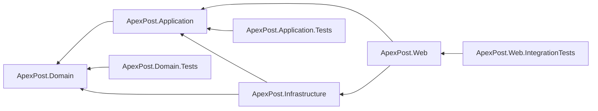
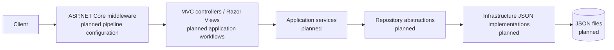

# ApexPost Logistics Design

## Current architecture

The solution is structured as a layered application. The project boundaries and references are configured, but the business model, use cases, persistence, and application-specific MVC workflows are not yet implemented.

| Project | Responsibility | Current state |
| --- | --- | --- |
| `ApexPost.Domain` | Business entities, value objects, and invariants. | Project shell only. |
| `ApexPost.Application` | Use cases, service contracts, and repository abstractions. | Project shell only. |
| `ApexPost.Infrastructure` | Technical adapters, including planned JSON persistence. | Project shell only. |
| `ApexPost.Web` | ASP.NET Core MVC UI and composition root. | Minimal MVC template; no application-specific registration or workflow. |
| `ApexPost.Domain.Tests` | Unit tests for Domain. | Template test only. |
| `ApexPost.Application.Tests` | Unit tests for Application. | Template test only. |
| `ApexPost.Web.IntegrationTests` | Integration tests for Web. | Template test only. |

## Verified project dependency flow

`ApexPost.Domain` deliberately has no solution-project references. This keeps business rules independent of HTTP, MVC, JSON, and persistence details. The dependency direction is inward: Application depends on Domain, Infrastructure adapts Application and Domain, and Web uses Application and Infrastructure at the outer edge.

## Composition root and dependency injection

`src/ApexPost.Web/Program.cs` is the composition root. It currently contains only template application setup. In a later step, it will register Application services and Infrastructure implementations with built-in `Microsoft.Extensions.DependencyInjection`, then configure the HTTP pipeline. Business logic will not be placed there.

## Planned HTTP request flow

The following is an intended design, not current functionality. Components marked **planned** do not yet exist in the implementation.

MVC, Razor Views, and the template HTTP pipeline are present through the ASP.NET Core template. The depicted application services, repository abstractions, JSON implementations, and JSON files remain planned.

## Test structure

Each test project references only the layer it tests: Domain Tests references Domain, Application Tests references Application, and Web Integration Tests references Web. The projects use xUnit; Web Integration Tests also references `Microsoft.AspNetCore.Mvc.Testing` for its planned web-hosting setup. Application-specific tests and use of that hosting setup are planned for later steps.

## Planned architectural components

Later steps may add domain entities and invariants, application service and repository-abstraction contracts, JSON persistence adapters, dependency-injection registrations, authentication and authorization, and MVC workflows. None of those components are implemented by this configuration step.
