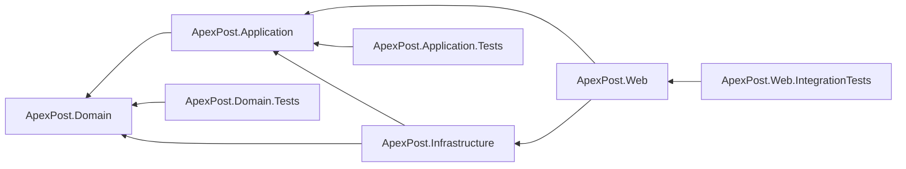
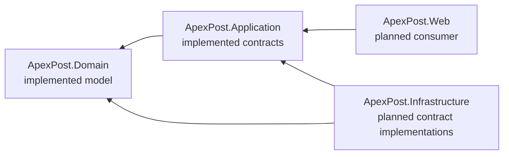
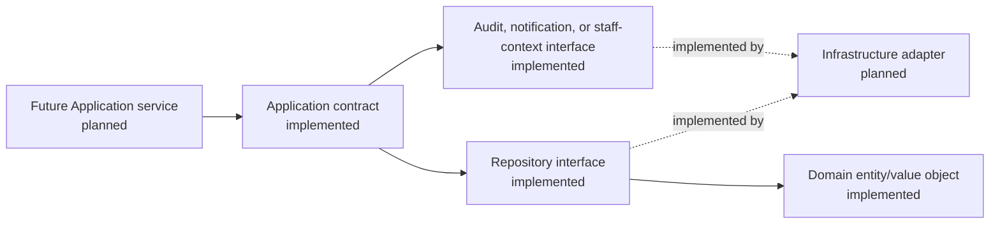
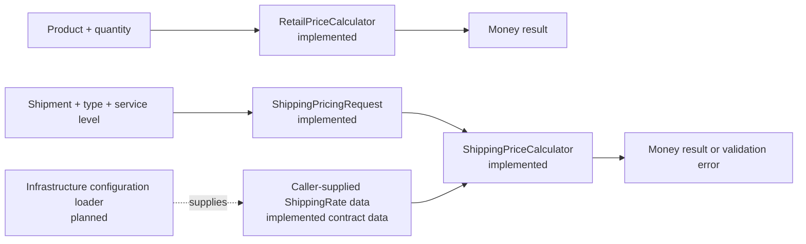
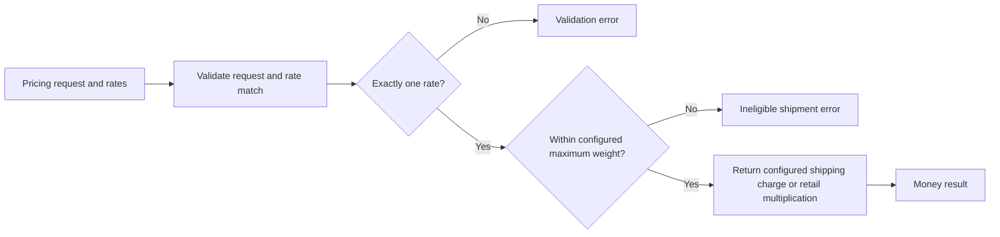
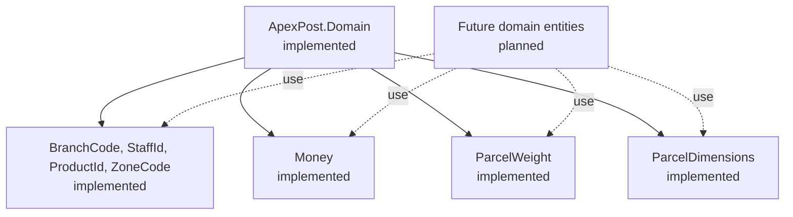
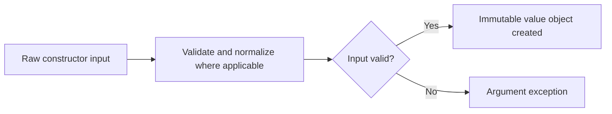
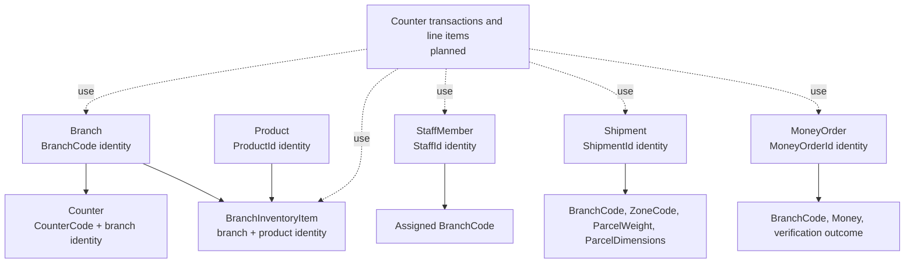
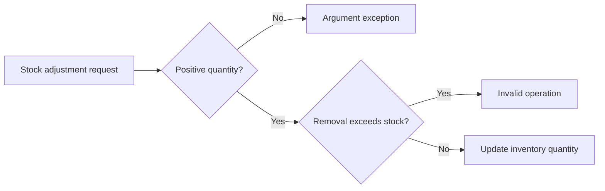
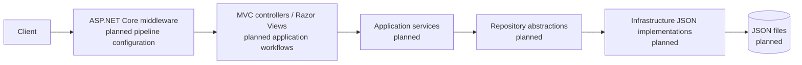

# ApexPost Logistics Design

## Current architecture

The solution is structured as a layered application. The Domain layer provides validated value objects and core entities, while Application owns contracts for persistence and external capabilities plus deterministic pricing calculators. Concrete persistence and application-specific MVC workflows are not yet implemented.

| Project | Responsibility | Current state |
| --- | --- | --- |
| `ApexPost.Domain` | Business entities, value objects, and invariants. | Core entities and local invariants implemented; workflows planned. |
| `ApexPost.Application` | Use cases, service contracts, repository abstractions, external-capability contracts, and pricing rules. | Repository, audit, notification, current-staff-context contracts, and pricing calculators implemented; services planned. |
| `ApexPost.Infrastructure` | Technical adapters, including planned JSON persistence. | Project shell only. |
| `ApexPost.Web` | ASP.NET Core MVC UI and composition root. | Minimal MVC template; no application-specific registration or workflow. |
| `ApexPost.Domain.Tests` | Unit tests for Domain. | Value-object and entity unit tests implemented. |
| `ApexPost.Application.Tests` | Unit tests for Application. | Template test only. |
| `ApexPost.Web.IntegrationTests` | Integration tests for Web. | Template test only. |

## Verified project dependency flow

`ApexPost.Domain` deliberately has no solution-project references. This keeps business rules independent of HTTP, MVC, JSON, and persistence details. The dependency direction is inward: Application depends on Domain, Infrastructure adapts Application and Domain, and Web uses Application and Infrastructure at the outer edge.

## Composition root and dependency injection

`src/ApexPost.Web/Program.cs` is the composition root. It currently contains only template application setup. In a later step, it will register Application services and Infrastructure implementations with built-in `Microsoft.Extensions.DependencyInjection`, then configure the HTTP pipeline. Business logic will not be placed there.

## Application contracts

Application owns repository interfaces for each implemented aggregate or independently persisted entity: branches, counters, staff members, products, branch inventory items, shipments, and money orders. Each contract returns an optional entity from `Find...Async` when absence is valid and persists an entity through `SaveAsync`. Every asynchronous operation accepts a final optional `CancellationToken`; contracts reveal neither file paths nor JSON details.

`ICurrentStaffContext` makes the current operator's `StaffId` and branch context available without referencing ASP.NET Core. `IAuditWriter` accepts an `AuditRecord` and `INotificationSender` accepts a `NotificationMessage`; their concrete delivery and storage remain planned Infrastructure responsibilities. Audit summaries must exclude identity-document numbers, credentials, and payment-card data.

## Pricing rules

Application owns the calculation logic. `RetailPriceCalculator` multiplies a `Product`'s existing `Money` unit price by a positive quantity, preserving decimal precision without rounding. `ShippingPriceCalculator` receives a `ShippingPricingRequest` and caller-supplied `ShippingRate` collection. A rate has a shipment type (`Letter` or `Parcel`), service level (`Standard`, `Express`, or `Registered`), destination zone, fixed `Money` charge, and maximum `ParcelWeight`.

The calculator requires exactly one matching rate and rejects a shipment above the selected rate's maximum weight; an equal weight is permitted. The assignment repository supplies no authoritative charge, formula, rounding rule, or dimensional surcharge, so the fixed charges and maximum weights are configuration data. Dimensions remain part of the validated `Shipment` but do not currently affect price. Infrastructure-based rate loading is planned.

## Domain value objects

The Domain layer contains immutable sealed records, so equality is value-based and instances cannot be modified after construction. `BranchCode`, `StaffId`, `ProductId`, and `ZoneCode` reject null, empty, and whitespace-only input, then trim and normalize codes to uppercase invariant text. The assignment does not provide code-pattern or length limits, so none are invented here.

`Money` retains its input as a `decimal` and accepts zero or positive amounts without rounding; currency and rounding policies are planned with future pricing and tax work. `ParcelWeight` represents a strictly positive kilogram value. `ParcelDimensions` represents strictly positive length, width, and height values in centimetres. Shipment weight limits remain a planned configurable business rule rather than a value-object maximum.

The implemented entities compose these types to retain validation at creation boundaries. Additional entities and cross-entity workflows remain planned.

## Domain entities

Entities are mutable only through their controlled operations and compare by identity rather than their changing state. `Branch` is identified by `BranchCode` and controls whether it is open. `Counter` is identified by its branch and `CounterCode`, and tracks its own open state. `StaffMember` is identified by `StaffId`, has an assigned branch and role, and prevents inactive members from processing transactions; the Counter Clerk role is limited to its assigned branch.

`Product` is identified by `ProductId` and owns its current `Money` unit price. `BranchInventoryItem` is identified by its branch/product pair and prevents quantity from becoming negative. `Shipment` is identified by `ShipmentId` and composes the existing origin, zone, weight, and dimensions value objects. `MoneyOrder` is identified by `MoneyOrderId`, stores a `Money` amount and verification outcome only, and deliberately has no identity-document data.

Branch closure and staff eligibility are exposed as entity state and operations. Coordinating those checks with counter transaction creation, shipment service limits, money-order thresholds, refunds, and authorization is planned application/domain-workflow work.

## Planned HTTP request flow

The following is an intended design, not current functionality. Components marked **planned** do not yet exist in the implementation.

MVC, Razor Views, and the template HTTP pipeline are present through the ASP.NET Core template. Application contracts and pricing calculators are implemented; the depicted application services, JSON implementations, and JSON files remain planned.

## Test structure

Each test project references only the layer it tests: Domain Tests references Domain, Application Tests references Application, and Web Integration Tests references Web. The projects use xUnit; Web Integration Tests also references `Microsoft.AspNetCore.Mvc.Testing` for its planned web-hosting setup. Application-specific tests and use of that hosting setup are planned for later steps.

## Planned architectural components

Later steps may add application services and workflows, JSON persistence adapters, dependency-injection registrations, authentication and authorization, and MVC workflows. Domain entities, Application contracts, and pricing calculators are already implemented; concrete contract implementations are not.
