# ApexPost Logistics Design

## Current architecture

The solution is a layered .NET 10 MVC application. Domain provides validated value objects and business entities; Application owns workflows and contracts; Infrastructure provides JSON adapters; and Web is the HTTP/MVC composition root. Persistence, MVC workflows, security controls, auditing, reports, and integration tests are implemented as described below.

| Project | Responsibility | Current state |
| --- | --- | --- |
| `ApexPost.Domain` | Business entities, value objects, and invariants. | Implemented. |
| `ApexPost.Application` | Use cases, service contracts, repository abstractions, external-capability contracts, and pricing rules. | Implemented workflows for inventory, shipping, money orders, transactions, and reports. |
| `ApexPost.Infrastructure` | Technical adapters, including JSON repository persistence. | Implements all current repository contracts. |
| `ApexPost.Web` | ASP.NET Core MVC UI and composition root. | Implemented MVC screens, filters, authentication/authorization, middleware, integration endpoint, and registrations. |
| `ApexPost.Domain.Tests` | Unit tests for Domain. | Value-object and entity unit tests implemented. |
| `ApexPost.Application.Tests` | Unit tests for Application. | Workflow, pricing, cancellation, failure, and concurrency coverage. |
| `ApexPost.Infrastructure.Tests` | Tests for JSON adapters and seed data. | Persistence, seed, cancellation, and concurrency coverage. |
| `ApexPost.Web.IntegrationTests` | Integration tests for Web. | Cookie, MVC filter, middleware, and integration-security coverage. |

## Verified project dependency flow

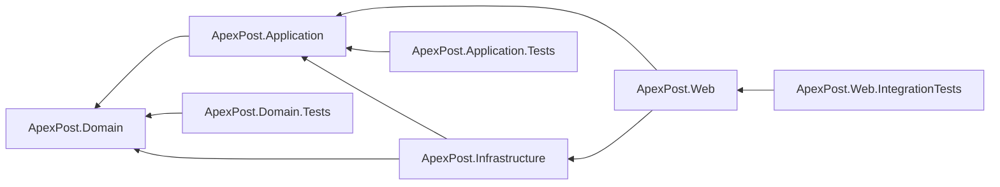

`ApexPost.Domain` deliberately has no solution-project references. This keeps business rules independent of HTTP, MVC, JSON, and persistence details. The dependency direction is inward: Application depends on Domain, Infrastructure adapts Application and Domain, and Web uses Application and Infrastructure at the outer edge.

## Composition root and dependency injection

`src/ApexPost.Web/Program.cs` is the composition root. It registers Infrastructure adapters, Application workflows, MVC filters, authentication/authorization, options, and middleware without placing business rules there.

## Application contracts

Application owns repository interfaces for each implemented aggregate or independently persisted entity: branches, counters, staff members, products, branch inventory items, shipments, and money orders. Each contract returns an optional entity from `Find...Async` when absence is valid and persists an entity through `SaveAsync`. Every asynchronous operation accepts a final optional `CancellationToken`; contracts reveal neither file paths nor JSON details.

`ICurrentStaffContext` makes the current operator's `StaffId` and branch context available without referencing ASP.NET Core. `IAuditStore` persists safe `AuditRecord` data through Infrastructure's `JsonAuditStore`; `INotificationSender` is fulfilled by local logging. Audit records exclude identity-document numbers, credentials, and payment-card data.

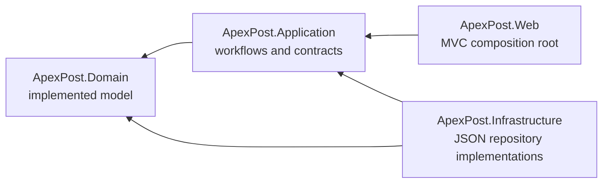

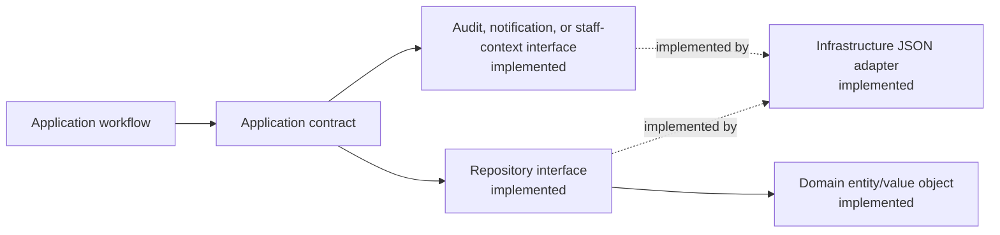

## Pricing rules

Application owns the calculation logic. `RetailPriceCalculator` multiplies a `Product`'s existing `Money` unit price by a positive quantity, preserving decimal precision without rounding. `ShippingPriceCalculator` receives a `ShippingPricingRequest` and caller-supplied `ShippingRate` collection. A rate has a shipment type (`Letter` or `Parcel`), service level (`Standard`, `Express`, or `Registered`), destination zone, fixed `Money` charge, and maximum `ParcelWeight`.

The calculator requires exactly one matching rate and rejects a shipment above the selected rate's maximum weight; an equal weight is permitted. The assignment repository supplies no authoritative charge, formula, rounding rule, or dimensional surcharge, so the fixed charges and maximum weights are configuration data. Dimensions remain part of the validated `Shipment` but do not currently affect price. `JsonShippingRateProvider` loads the configured JSON rates.

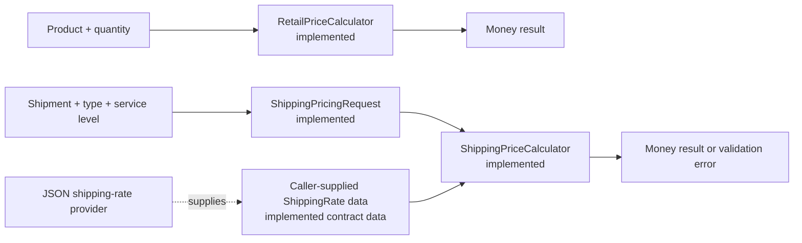

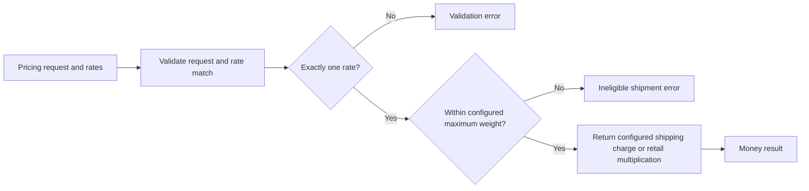

## Domain value objects

The Domain layer contains immutable sealed records, so equality is value-based and instances cannot be modified after construction. `BranchCode`, `StaffId`, `ProductId`, and `ZoneCode` reject null, empty, and whitespace-only input, then trim and normalize codes to uppercase invariant text. The assignment does not provide code-pattern or length limits, so none are invented here.

`Money` retains its input as a `decimal` and accepts zero or positive amounts without rounding; currency and rounding policies remain deliberately unspecified. `ParcelWeight` represents a strictly positive kilogram value. `ParcelDimensions` represents strictly positive length, width, and height values in centimetres. Shipment weight limits are configured per shipping rate rather than embedded in the value object.

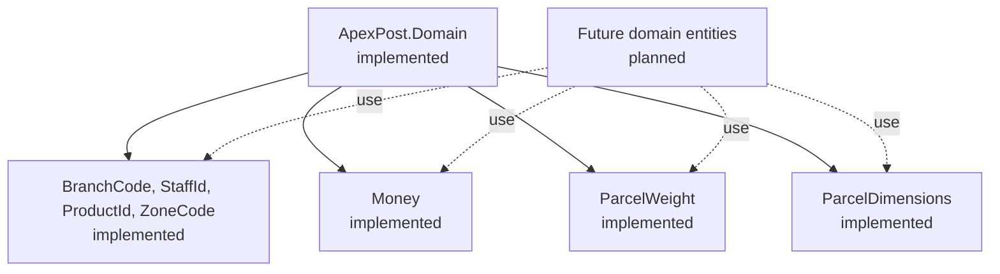

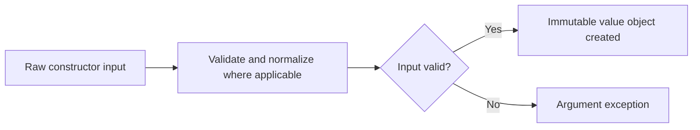

The implemented entities compose these types to retain validation at creation boundaries. Additional entities and cross-entity workflows remain planned.

## Domain entities

Entities are mutable only through their controlled operations and compare by identity rather than their changing state. `Branch` is identified by `BranchCode` and controls whether it is open. `Counter` is identified by its branch and `CounterCode`, and tracks its own open state. `StaffMember` is identified by `StaffId`, has an assigned branch and role, and prevents inactive members from processing transactions; the Counter Clerk role is limited to its assigned branch.

`Product` is identified by `ProductId` and owns its current `Money` unit price. `BranchInventoryItem` is identified by its branch/product pair and prevents quantity from becoming negative. `Shipment` is identified by `ShipmentId` and composes the existing origin, zone, weight, and dimensions value objects. `MoneyOrder` is identified by `MoneyOrderId`, stores a `Money` amount and verification outcome only, and deliberately has no identity-document data.

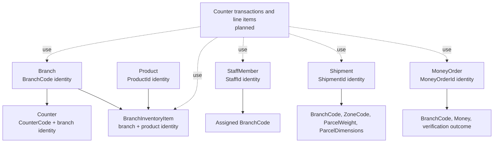

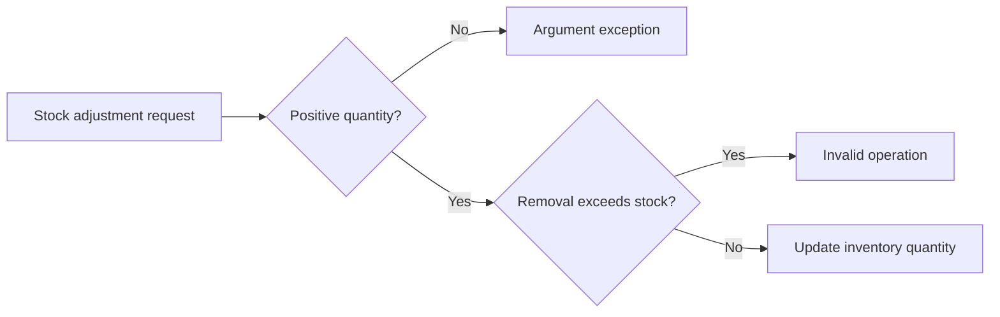

Branch closure and staff eligibility are entity state and operations. Application workflows coordinate those checks with checkout, shipment creation, money-order thresholds, refunds, and HTTP authorization.

## Step 7 JSON repository persistence

Infrastructure implements only the existing Application repository abstractions: `IBranchRepository`, `ICounterRepository`, `IStaffMemberRepository`, `IProductRepository`, `IInventoryRepository`, `IShipmentRepository`, and `IMoneyOrderRepository`. No delete contract exists, so deletion is deliberately not added. Each `SaveAsync` upserts by the Domain identity and `Find...Async` returns `null` when data is absent.

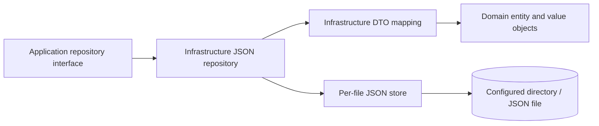

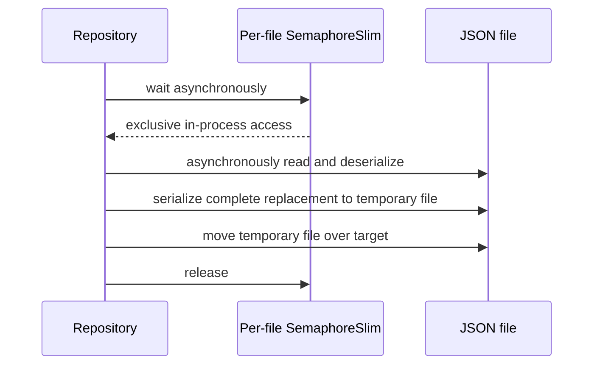

`JsonRepositoryOptions.DataDirectory` selects the data directory. The fixed filenames are `branches.json`, `counters.json`, `staff-members.json`, `products.json`, `inventory.json`, `shipments.json`, and `money-orders.json`. DTOs are Infrastructure-only. Money orders persist verification outcome but never an identity-document number.

Missing files are treated as empty repositories. Empty, null, malformed, and domain-invalid JSON throws instead of being replaced; I/O exceptions also reach the caller. File streams are asynchronous and contract cancellation tokens are propagated. A process-wide, path-keyed `SemaphoreSlim` protects each read-modify-write operation for all repository instances in this process; it provides no cross-process coordination. A complete JSON payload is written to a unique temporary file in the same directory, then moved over the target, avoiding a truncated target if serialization fails. Atomic replacement and durability are filesystem/platform dependent, and operations spanning multiple files are not transactional.

## Step 8 deterministic demo seed data

`DemoDataSeeder` is an Infrastructure component, not a web startup action. It builds valid Domain entities and saves branches, counters, staff, products, and inventory through JSON repositories. It also writes `shipping-rates.json`, consumed by `JsonShippingRateProvider`, and `historical-transactions.json`, which remains a seed snapshot separate from runtime `CounterTransaction` persistence. Seeded staff do not create usable login accounts until a local password secret is configured.

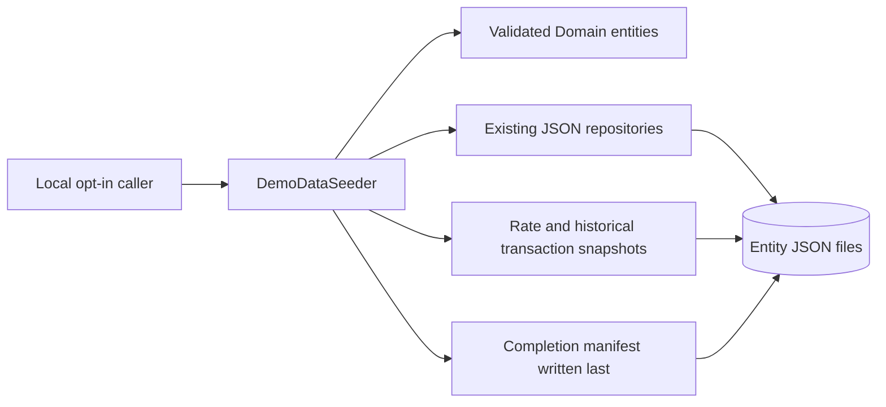

The seeder accepts only a nonexistent or empty configured data directory. It writes the fixed `apexpost-demo-v1` manifest last; a matching manifest makes a later call a no-op. If any unmarked data or an incompatible manifest exists, it fails without changing files. This protects user data but cannot make a failed multi-file initial seed atomic: a partial seed has no completion manifest and must be inspected or removed explicitly by the local operator before retrying. All identities are synthetic and no document references, passwords, or secrets are produced.

## Step 9 inventory application behavior

`InventoryService` owns inventory orchestration in Application. `BranchInventoryItem` remains the Domain owner of positive-change and non-negative-stock invariants. The narrowly extended `IInventoryRepository.UpdateAsync` contract runs one mutation against one branch/product item without exposing an intervening read/write window. `JsonInventoryRepository` implements it inside the existing `inventory.json` per-file lock.

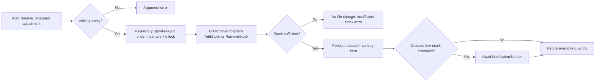

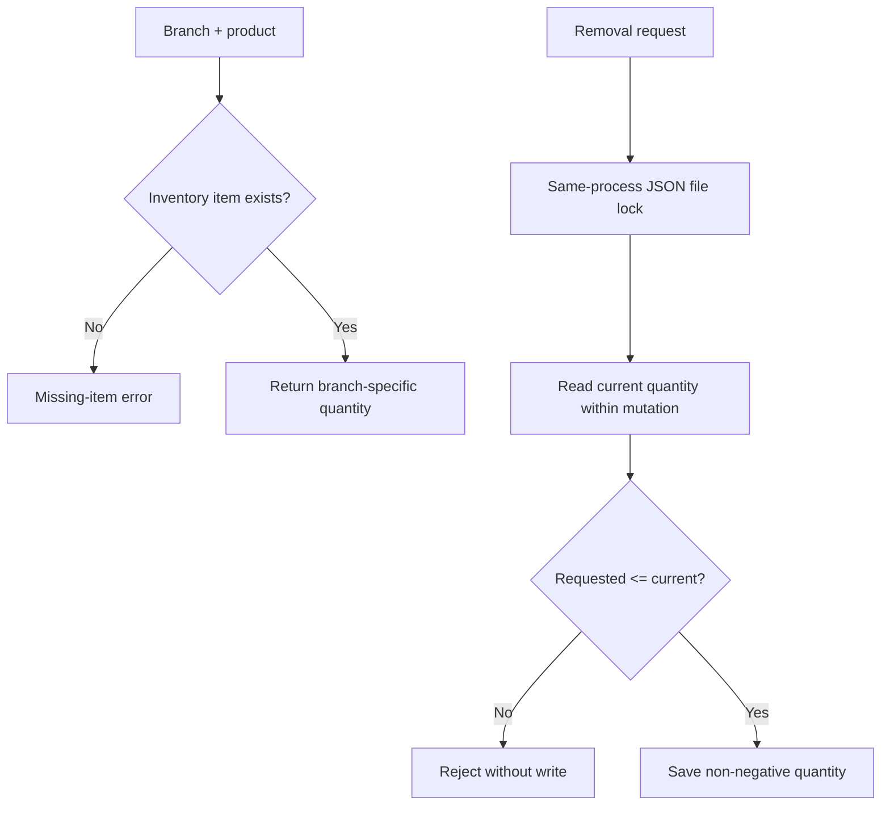

The JSON lock is process-wide and keyed by the inventory file path, so concurrent operations through JSON repository instances in one application process cannot oversell. It is not a cross-process lock and does not provide distributed transactions. Low-stock alerts are sent only on a downward threshold crossing and are awaited; without an outbox, a notification delivery failure can be reported after persistence, and delivery is not retried in this step.

## Step 10 shipping workflow

`ShippingWorkflowService` is an Application-layer coordinator. It translates raw request data into the existing validated Domain `Shipment` and value objects, checks the origin branch through `IBranchRepository`, obtains storage-agnostic configured rates through `IShippingRateProvider`, delegates all matching, fixed-price, and maximum-weight behavior to `ShippingPriceCalculator`, then saves through `IShipmentRepository`. `JsonShippingRateProvider` is the Infrastructure implementation that reads `shipping-rates.json` asynchronously.

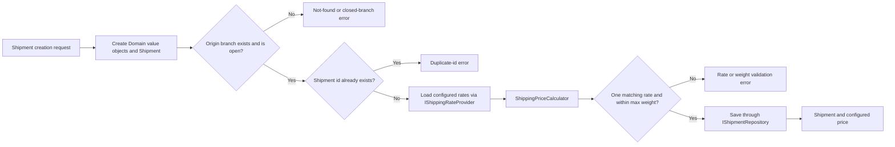

The workflow does not define rates, formulas, dimensional surcharges, or a universal service limit. `shipping-rates.json` supplies one fixed charge and maximum weight for each applicable type/service/zone. The current Domain model requires positive dimensions for every shipment, including a letter, and no additional type-specific dimensions are invented. Persistence I/O errors propagate unchanged; missing origin branches and shipment retrieval use explicit Application exceptions. The MVC flow presents a label preview; carrier integration and rendered carrier labels are not implemented.

## Step 11 money orders and identity verification

`MoneyOrderWorkflowService` coordinates persistence and configured policy while `MoneyOrder` owns its amount, fee, sender, recipient, context identity, and verification-association invariants. `IMoneyOrderPolicy` provides `HighValueThreshold`; the application requires a supplied configuration value and does not hard-code a production threshold. An amount strictly greater than the threshold must have a successful `IdentityVerificationRecord` with the same `MoneyOrderContextId` before the repository save occurs.

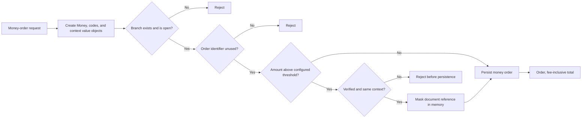

The raw identity-document number is transient request input only. Application converts it to `MaskedIdentityDocumentReference`; Domain and JSON persistence retain document type, verification outcome, transaction context, and only the masked representation. No external identity-provider call, audit filter, authentication, counter transaction, or MVC feature exists in this step. The policy threshold must be supplied by a future composition/configuration step, and currency/fee calculation policy remain intentionally unresolved.

## Step 12 mixed counter transactions

`CounterTransaction` is a Domain aggregate for branch/counter/clerk identity, immutable basket lines, subtotal, tax, payment method, and state. It allows `Open → Paid`, `Open → Voided`, and `Paid → Refunded`; manager authorization and reason input are validated at the Application boundary before the Domain transition. `CounterTransactionWorkflowService` validates branch, counter, clerk, existing money orders, stock, and configured tax policy. `ICounterTransactionRepository` is implemented by `JsonCounterTransactionRepository` in `counter-transactions.json`.

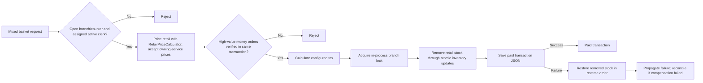

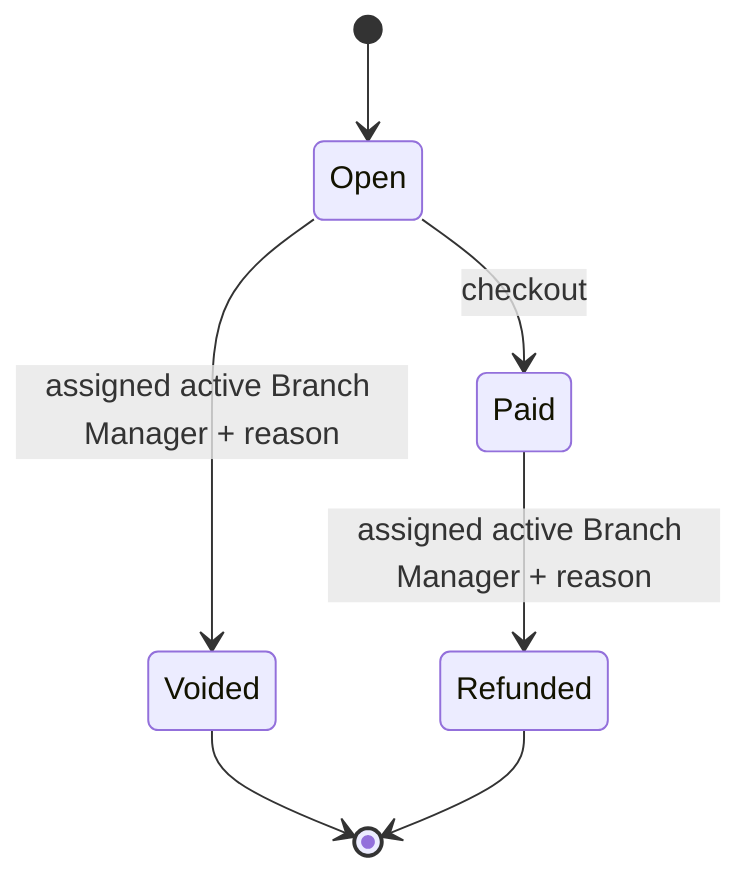

Multi-file JSON persistence is not atomic. The service uses an in-process branch lock to serialize its own mixed-basket workflows and the existing per-file inventory mutation lock to prevent overselling. Checkout removes stock before saving the transaction and compensates it if save fails; if a process ends between writes or a compensation write fails, reconciliation is required. Refund persists its status before restoring inventory and explicitly reports a restoration failure; voiding an open basket restores no stock because checkout only removes stock when it marks a transaction paid. These guarantees do not coordinate multiple application processes sharing JSON files, nor do they provide database-grade atomicity.

## Step 13 reports and simulated notifications

`BranchReportService` has four focused branch-scoped queries: paid daily sales split by retail/service plus tax, inventory at/below a caller-supplied threshold, shipment count grouped by destination zone/service level, and money-order verification outcome counts. The repository contracts add focused branch filters; no generic specification framework is introduced. Report reads are sequenced deliberately: each JSON repository uses its own same-process file lock, while `Task.WhenAll` would add little benefit and create a potentially inconsistent cross-file snapshot.

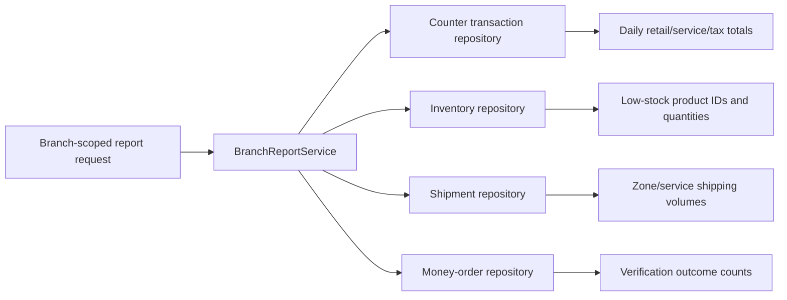

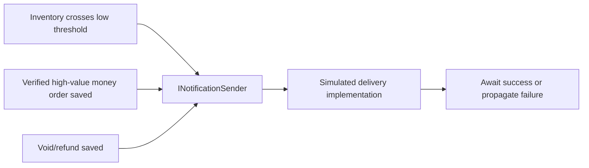

Notifications are observer-style calls through the existing Application abstraction, not an external provider. Each is sent after the relevant persistence succeeds; a delivery failure is observable to the caller but is not a distributed transaction and does not undo the stock/order/transaction state. Reports intentionally omit money-order sender, recipient, document type, and masked reference.

## Step 14 MVC request flow

```mermaid
flowchart LR
    Client[Browser] --> Routing[Conventional MVC routing]
    Routing --> Controller[Thin controller + view model validation]
    Controller --> AppService[Application workflow or report service]
    AppService --> Repository[Application repository abstraction]
    Repository --> Infrastructure[Infrastructure JSON implementation]
    Infrastructure --> Files[(Configured JSON files)]
    Controller --> Razor[Razor View / PRG redirect]
```

Controllers convert HTTP/view-model input into Application requests and return Views, redirects after successful POSTs, or relevant HTTP status results. They do not contain pricing, stock, verification, or persistence rules. Authentication/authorization is explicitly outside this step, despite the login UI placeholder.

## Step 15 authentication and authorization flow

```mermaid
flowchart TD
    Login[Login form + antiforgery token] --> Credentials[Local demo credential configuration]
    Credentials --> Staff[Load StaffMember from repository]
    Staff -->|Active| Claims[Issue HttpOnly cookie: StaffId, Role, BranchCode]
    Staff -->|Inactive / missing / invalid| Deny[Generic sign-in failure]
    Claims --> Request[Protected MVC request]
    Request --> Recheck[Reload staff record]
    Recheck -->|Active, role and branch unchanged| Policy[Role and SameBranchOnly policies]
    Recheck -->|Inactive or changed| Reject[Reject cookie and redirect to login]
    Policy --> Clerk[Counter Clerk own-branch workflows]
    Policy --> Manager[BranchManagerOnly void/refund + reason]
    Policy --> Reports[Auditor / Administrator / Manager own-branch reports]
```

Cookies are validated against the persisted staff record on every authenticated request. The application service remains the final authority for manager assignment, active staff status, transaction status transitions, and reversal reasons; endpoint policies reduce the HTTP attack surface but do not replace Domain/Application invariants.

## Step 16 middleware pipeline

```mermaid
flowchart TD
    Request --> Correlation[Correlation ID: validate/generate and echo]
    Correlation --> Timing[Structured request timing/logging]
    Timing --> Errors[Safe Problem Details exception boundary]
    Errors --> Headers[Security headers via OnStarting]
    Headers --> HTTPS[HSTS outside Development + HTTPS redirect]
    HTTPS --> Routing[Endpoint routing]
    Routing --> Maintenance[Maintenance mode; /health bypass]
    Maintenance --> CORS[Approved partner CORS policy]
    CORS --> Limits[Login/partner rate limits]
    Limits --> ApiKey[Integration API-key metadata check]
    ApiKey --> IP[Integration/admin IP allowlist metadata check]
    IP --> Cookie[Cookie authentication]
    Cookie --> Authz[Role and branch authorization]
    Authz --> Endpoint[MVC, integration, or health endpoint]
```

Correlation runs first so every later log/error response has an ID. Timing surrounds the exception boundary so failures are measured. Headers are registered before short-circuiting controls. Routing precedes endpoint-metadata middleware; CORS handles approved preflight requests before API-key checks. API-key and IP checks occur before cookie processing because the integration endpoint is partner-authenticated rather than user-authenticated. `/health` is mapped after the pipeline but bypasses maintenance by path so infrastructure can still observe the service.

## Step 17 MVC filters and audit boundary

`IAuditStore` lives in Application because it describes an operational requirement without choosing a persistence mechanism. `JsonAuditStore` lives in Infrastructure and writes `audit-records.json` through the existing asynchronous, path-keyed JSON lock. The store exposes only `AppendAsync` and `ReadAsync`; it has no mutation or deletion operation. An `AuditRecord` contains UTC occurrence time, nullable authenticated staff ID/role/branch, controller/action, allow-listed route values, status code, duration, correlation ID, and outcome. It deliberately does not have a request-body, model, summary, or exception-detail field.

`AuditActionFilter`, `ValidationActionFilter`, and `PerformanceActionFilter` are registered globally using `AddService`, so DI supplies the store, logger, and options. Audit runs outermost so an invalid model is still audited; validation returns the bound model to a conventional MVC view, while endpoints explicitly marked `InvalidModelResponse` and API controllers receive `400 ValidationProblemDetails`. Performance logging is configurable through `ApexPost:Performance:WarningThresholdMilliseconds` and emits a warning at or above the threshold.

| Concern | MVC filter | Middleware |
| --- | --- | --- |
| Audit controller/action and model-validation outcome | Has selected action descriptor, route data, action result, and ModelState | Runs before/after endpoint execution but does not naturally observe action result or ModelState |
| MVC invalid-model response | Can choose View vs `ValidationProblemDetails` using controller/action metadata | Cannot safely select an MVC result/view model |
| Action performance warning | Measures the action/filter segment and logs controller/action identity | Better for complete HTTP pipeline latency, already handled by request logging middleware |
| Correlation IDs, headers, CORS, API-key/IP checks | Too early or HTTP-wide for an action filter | Correctly applies to all matching requests, including non-MVC endpoints |

```mermaid
flowchart TD
    Request --> Correlation[Correlation middleware assigns/reuses ID]
    Correlation --> Auth[Authentication and authorization]
    Auth --> Audit[AuditActionFilter starts timer]
    Audit --> Validation[ValidationActionFilter]
    Validation -->|Invalid| Invalid[View or 400 ValidationProblemDetails]
    Validation -->|Valid| Performance[PerformanceActionFilter]
    Performance --> Action[Sales / void / refund / money order / identity / stock action]
    Action --> Result[Action result]
    Invalid --> Record[Safe AuditRecord]
    Result --> Record
    Record --> Store[IAuditStore.AppendAsync]
    Store --> Json[Infrastructure audit-records.json]
```

The JSON implementation is append-only at the application API: it serializes same-process appends and writes a complete replacement document. It is not tamper-proof, WORM storage, a cross-process lock, or a durable ledger. File permissions, retention, integrity controls, off-host replication, and a ledger-capable audit service are required for those properties.

## Step 18 test architecture

Tests follow the production dependency direction. Domain tests exercise entity/value-object invariants without I/O. Application tests use deterministic in-memory repository/notification collaborators to cover workflows, cancellation, and failure propagation. Infrastructure tests use a unique OS-temporary directory per test and clean only that owned directory. Web integration tests start the actual composition root through `WebApplicationFactory`, set synthetic in-memory configuration, and use cookie/antiforgery interactions through `HttpClient`; no test uses a real credential, external service, or arbitrary delay.

```mermaid
flowchart LR
    DomainTests[Domain tests\nvalue objects and invariants] --> Domain
    AppTests[Application tests\nin-memory collaborators] --> Application
    InfraTests[Infrastructure tests\nunique temp JSON directory] --> Infrastructure
    WebTests[Web integration tests\nWebApplicationFactory + test config] --> Web
    Web --> Application
    Web --> Infrastructure
```

The security integration suite tests the full HTTP pipeline rather than individual middleware in isolation: headers/correlation IDs, API-key failure, IP deny, fixed-window rate limiting, authentication redirect, and unauthorized Clerk reversal requests. TestServer does not provide a realistic remote IP for manager reversal calls; those requests are expected to be denied by the existing IP gate, while the integration endpoint independently verifies the configured-blocked-IP behavior.

## Step 19 concurrency and advanced C# review

The codebase uses advanced C# features to support concrete concerns, not as a checklist. Immutable records and validated value objects carry business data safely; pattern matching selects status/rate behavior; generic `JsonFileStore<TDocument>` accepts `Func`/`Action` delegates so a document mutation remains inside its file lock; custom endpoint metadata selects MVC validation behavior; and `INotificationSender` is an awaited observer abstraction. All persistence/workflow calls are asynchronous and take a `CancellationToken`; cancellation tests keep it distinct from malformed-data and I/O failures.

`SemaphoreSlim` is used for same-process per-file serialization and per-branch checkout/reversal serialization. Both acquisition paths pass cancellation to `WaitAsync` and release only in `finally`. Checkout validation now fans out branch, counter, clerk, and duplicate-ID reads using `Task.WhenAll`: they query independent aggregates and have no ordering dependency. It intentionally does not parallelize stock changes, transaction persistence, compensation, report reads, or audit writes—those require ordering, coherent behavior, or lock protection.

```mermaid
flowchart TD
    Checkout[Checkout request] --> Gate[Per-branch SemaphoreSlim]
    Gate --> Reads[Independent validation reads]
    Reads --> Fanout[Task.WhenAll: branch, counter, clerk, transaction ID]
    Fanout --> Build[Build and price basket]
    Build --> Stock[Ordered atomic inventory updates]
    Stock --> Save[Save transaction]
    Save -->|Failure| Compensate[Reverse ordered stock changes]
    Save -->|Success| Done[Paid transaction]
    Json[JSON repository update] --> FileGate[Per-file SemaphoreSlim]
    FileGate --> CompleteWrite[Async temp write then replace]
```

No benchmark framework or representative load profile exists in the repository, so the review records no fabricated throughput/latency values. It identifies reduced sequential waiting as a design improvement only. `ValueTask` and an in-memory cache are intentionally absent: the JSON shipping-rate source has no measured hot-read profile, and cache invalidation would change configuration freshness semantics. The notification adapter is synchronous local logging rather than an external lookup; therefore no timeout is appropriate today. A future external provider must combine a bounded timeout with the request cancellation token and surface cancellation separately from provider failure.

## Step 20 delivery architecture decisions

### SOLID mapping

| Principle | Actual code | Why it applies |
| --- | --- | --- |
| Single responsibility | `ShippingWorkflowService`, `InventoryService`, `JsonFileStore<TDocument>`, MVC controllers | Workflows coordinate one use case; JSON store owns file access/locking; controllers translate HTTP only. |
| Open/closed | `IShippingRateProvider`, `INotificationSender`, `IAuditStore`, repository interfaces | A provider/store/sender can be replaced without changing workflows. |
| Liskov substitution | JSON and test in-memory repository implementations | Workflows consume contract behavior and tests substitute deterministic implementations. |
| Interface segregation | Separate repository, notification, audit, pricing, and tax contracts | Consumers do not depend on unrelated persistence or delivery operations. |
| Dependency inversion | Application workflows depend on contracts; `Program.cs` supplies JSON/logging adapters | Business rules do not reference MVC or JSON types. |

### DI lifetime decisions

| Lifetime | Registrations | Rationale and capture prevention |
| --- | --- | --- |
| Singleton | JSON repositories/store/provider, Application workflows, policies/options, local authenticator, logging notification sender | These services are stateless or own process-wide file locks/configuration. They depend only on singleton-safe collaborators and do not capture request/scoped services. |
| Scoped | MVC audit, validation, and performance filters | Filters are resolved per MVC request through `AddService`; they receive singleton-safe store/options/logging dependencies. |
| Framework-managed request state | `HttpContext`, authentication principal, controller instances | It is accessed only within request/filter/controller execution and is not stored in singleton services. |

### Security, audit, and deployment notes

| Threat or concern | Current mitigation | Remaining boundary |
| --- | --- | --- |
| Credential/API-key disclosure | User secrets guidance, constant-time integration key comparison, generic sign-in failures, no secrets committed | No production credential lifecycle or vault integration. |
| Cross-branch/role abuse | Cookie claims are revalidated against persisted staff; role and branch policies plus Application checks | No MFA or distributed session revocation. |
| Sensitive audit leakage | Audit filter allow-lists route identifiers and never serializes bodies/models/headers | Filesystem writers can alter JSON audit data. |
| Request correlation and unsafe errors | Correlation middleware, safe Problem Details, security headers | Proxy deployments must configure trusted forwarded headers. |
| JSON corruption/concurrency | Async temporary replacement writes and same-process semaphores | No cross-process lock or multi-file transaction. |

Deployment configuration belongs outside source control: data directory, local/demo passwords, integration API key, IP allowlist, partner origin, rate limits, thresholds, and maintenance settings. Terminate or serve TLS in production; configure explicit trusted proxies before enabling forwarded headers for client-IP policies. `/health` is intentionally available during maintenance mode for infrastructure checks.

### Architecture decision records

These ADRs document existing decisions at Step 20; they do not claim unrecorded historical deliberation.

1. [ADR 0001 — layered project dependencies](docs/adr/0001-layered-project-dependencies.md)
2. [ADR 0002 — JSON persistence and same-process locking](docs/adr/0002-json-persistence-and-same-process-locking.md)
3. [ADR 0003 — local cookie authentication](docs/adr/0003-local-cookie-authentication.md)
4. [ADR 0004 — ordered security middleware](docs/adr/0004-order-security-middleware-before-endpoints.md)
5. [ADR 0005 — MVC action audit with JSON store](docs/adr/0005-mvc-action-audit-with-json-store.md)
6. [ADR 0006 — parallelize only independent checkout reads](docs/adr/0006-parallelize-only-independent-checkout-reads.md)

```mermaid
flowchart TD
    Login[Login UI placeholder] --> Dashboard[Branch dashboard]
    Dashboard --> Catalogue[Catalogue and branch stock]
    Catalogue --> Basket[Counter basket]
    Dashboard --> Shipping[Create shipment]
    Shipping --> Label[Shipping-label preview]
    Dashboard --> Money[Money order + identity form]
    Dashboard --> Reports[Branch reports]
    Basket --> Receipt[POST then redirect]
    Money --> Receipt
```

## Test structure

Each test project references only the layer it tests: Domain Tests references Domain, Application Tests references Application, and Web Integration Tests references Web. The projects use xUnit; Web Integration Tests uses `Microsoft.AspNetCore.Mvc.Testing` to exercise MVC routes and form validation through a test host.

## Future architectural work

Future work requires explicit decisions for production identity, payment, notification, carrier, currency/rounding, cache invalidation, distributed concurrency, audit retention/integrity, and reconciliation infrastructure. These are not represented as completed features.
