# ApexPost Logistics Design

## Current architecture

The solution is structured as a layered application. The Domain layer provides validated value objects and core entities, while Application owns contracts for persistence and external capabilities plus deterministic pricing calculators. Concrete persistence and application-specific MVC workflows are not yet implemented.

| Project | Responsibility | Current state |
| --- | --- | --- |
| `ApexPost.Domain` | Business entities, value objects, and invariants. | Core entities and local invariants implemented; workflows planned. |
| `ApexPost.Application` | Use cases, service contracts, repository abstractions, external-capability contracts, and pricing rules. | Repository, audit, notification, current-staff-context contracts, and pricing calculators implemented; services planned. |
| `ApexPost.Infrastructure` | Technical adapters, including JSON repository persistence. | Implements all current repository contracts. |
| `ApexPost.Web` | ASP.NET Core MVC UI and composition root. | Minimal MVC template; no application-specific registration or workflow. |
| `ApexPost.Domain.Tests` | Unit tests for Domain. | Value-object and entity unit tests implemented. |
| `ApexPost.Application.Tests` | Unit tests for Application. | Template test only. |
| `ApexPost.Web.IntegrationTests` | Integration tests for Web. | Template test only. |

## Verified project dependency flow

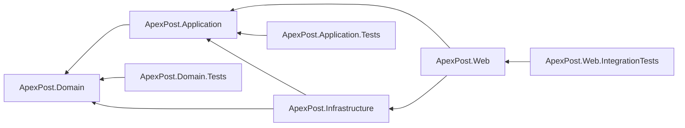

`ApexPost.Domain` deliberately has no solution-project references. This keeps business rules independent of HTTP, MVC, JSON, and persistence details. The dependency direction is inward: Application depends on Domain, Infrastructure adapts Application and Domain, and Web uses Application and Infrastructure at the outer edge.

## Composition root and dependency injection

`src/ApexPost.Web/Program.cs` is the composition root. It currently contains only template application setup. In a later step, it will register Application services and Infrastructure implementations with built-in `Microsoft.Extensions.DependencyInjection`, then configure the HTTP pipeline. Business logic will not be placed there.

## Application contracts

Application owns repository interfaces for each implemented aggregate or independently persisted entity: branches, counters, staff members, products, branch inventory items, shipments, and money orders. Each contract returns an optional entity from `Find...Async` when absence is valid and persists an entity through `SaveAsync`. Every asynchronous operation accepts a final optional `CancellationToken`; contracts reveal neither file paths nor JSON details.

`ICurrentStaffContext` makes the current operator's `StaffId` and branch context available without referencing ASP.NET Core. `IAuditWriter` accepts an `AuditRecord` and `INotificationSender` accepts a `NotificationMessage`; their concrete delivery and storage remain planned Infrastructure responsibilities. Audit summaries must exclude identity-document numbers, credentials, and payment-card data.

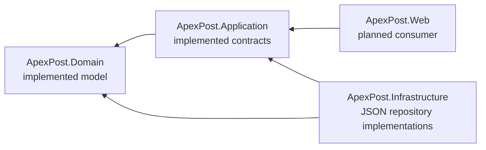

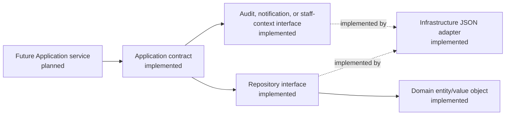

## Pricing rules

Application owns the calculation logic. `RetailPriceCalculator` multiplies a `Product`'s existing `Money` unit price by a positive quantity, preserving decimal precision without rounding. `ShippingPriceCalculator` receives a `ShippingPricingRequest` and caller-supplied `ShippingRate` collection. A rate has a shipment type (`Letter` or `Parcel`), service level (`Standard`, `Express`, or `Registered`), destination zone, fixed `Money` charge, and maximum `ParcelWeight`.

The calculator requires exactly one matching rate and rejects a shipment above the selected rate's maximum weight; an equal weight is permitted. The assignment repository supplies no authoritative charge, formula, rounding rule, or dimensional surcharge, so the fixed charges and maximum weights are configuration data. Dimensions remain part of the validated `Shipment` but do not currently affect price. Infrastructure-based rate loading is planned.

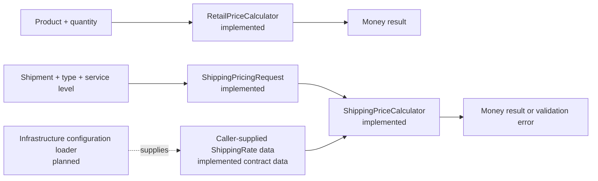

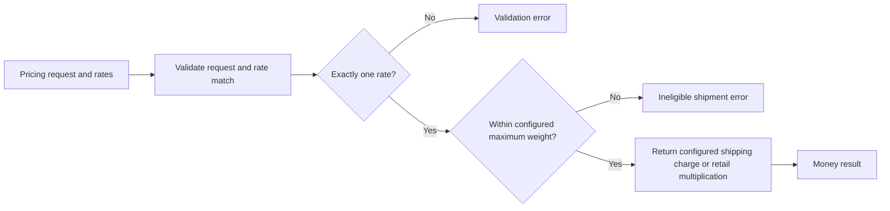

## Domain value objects

The Domain layer contains immutable sealed records, so equality is value-based and instances cannot be modified after construction. `BranchCode`, `StaffId`, `ProductId`, and `ZoneCode` reject null, empty, and whitespace-only input, then trim and normalize codes to uppercase invariant text. The assignment does not provide code-pattern or length limits, so none are invented here.

`Money` retains its input as a `decimal` and accepts zero or positive amounts without rounding; currency and rounding policies are planned with future pricing and tax work. `ParcelWeight` represents a strictly positive kilogram value. `ParcelDimensions` represents strictly positive length, width, and height values in centimetres. Shipment weight limits remain a planned configurable business rule rather than a value-object maximum.

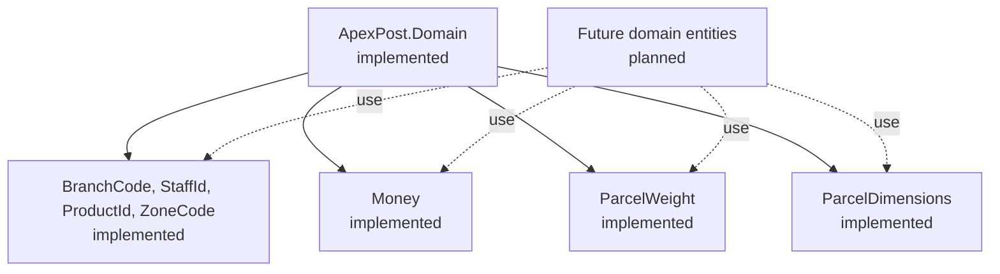

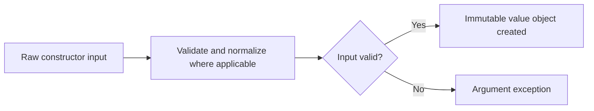

The implemented entities compose these types to retain validation at creation boundaries. Additional entities and cross-entity workflows remain planned.

## Domain entities

Entities are mutable only through their controlled operations and compare by identity rather than their changing state. `Branch` is identified by `BranchCode` and controls whether it is open. `Counter` is identified by its branch and `CounterCode`, and tracks its own open state. `StaffMember` is identified by `StaffId`, has an assigned branch and role, and prevents inactive members from processing transactions; the Counter Clerk role is limited to its assigned branch.

`Product` is identified by `ProductId` and owns its current `Money` unit price. `BranchInventoryItem` is identified by its branch/product pair and prevents quantity from becoming negative. `Shipment` is identified by `ShipmentId` and composes the existing origin, zone, weight, and dimensions value objects. `MoneyOrder` is identified by `MoneyOrderId`, stores a `Money` amount and verification outcome only, and deliberately has no identity-document data.

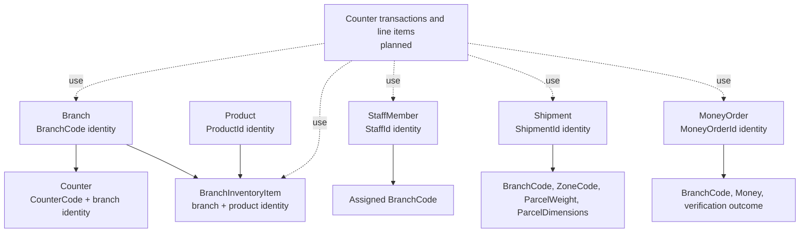

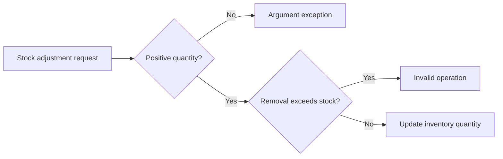

Branch closure and staff eligibility are exposed as entity state and operations. Coordinating those checks with counter transaction creation, shipment service limits, money-order thresholds, refunds, and authorization is planned application/domain-workflow work.

## Step 7 JSON repository persistence

Infrastructure implements only the existing Application repository abstractions: `IBranchRepository`, `ICounterRepository`, `IStaffMemberRepository`, `IProductRepository`, `IInventoryRepository`, `IShipmentRepository`, and `IMoneyOrderRepository`. No delete contract exists, so deletion is deliberately not added. Each `SaveAsync` upserts by the Domain identity and `Find...Async` returns `null` when data is absent.

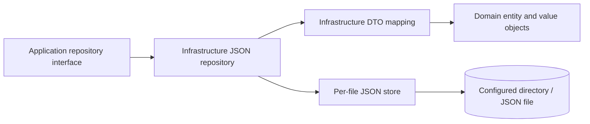

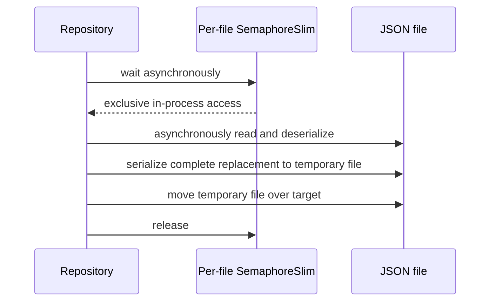

`JsonRepositoryOptions.DataDirectory` selects the data directory. The fixed filenames are `branches.json`, `counters.json`, `staff-members.json`, `products.json`, `inventory.json`, `shipments.json`, and `money-orders.json`. DTOs are Infrastructure-only. Money orders persist verification outcome but never an identity-document number.

Missing files are treated as empty repositories. Empty, null, malformed, and domain-invalid JSON throws instead of being replaced; I/O exceptions also reach the caller. File streams are asynchronous and contract cancellation tokens are propagated. A process-wide, path-keyed `SemaphoreSlim` protects each read-modify-write operation for all repository instances in this process; it provides no cross-process coordination. A complete JSON payload is written to a unique temporary file in the same directory, then moved over the target, avoiding a truncated target if serialization fails. Atomic replacement and durability are filesystem/platform dependent, and operations spanning multiple files are not transactional.

## Step 8 deterministic demo seed data

`DemoDataSeeder` is an Infrastructure component, not a web startup action. It builds valid Domain entities and saves branches, counters, staff, products, and inventory through the existing JSON repositories. It also writes `shipping-rates.json`, now consumed by `JsonShippingRateProvider` through the Application `IShippingRateProvider` abstraction, and `historical-transactions.json`, which remains a seed snapshot because there is no transaction aggregate. These records do not implement transaction, reporting, or authentication workflows.

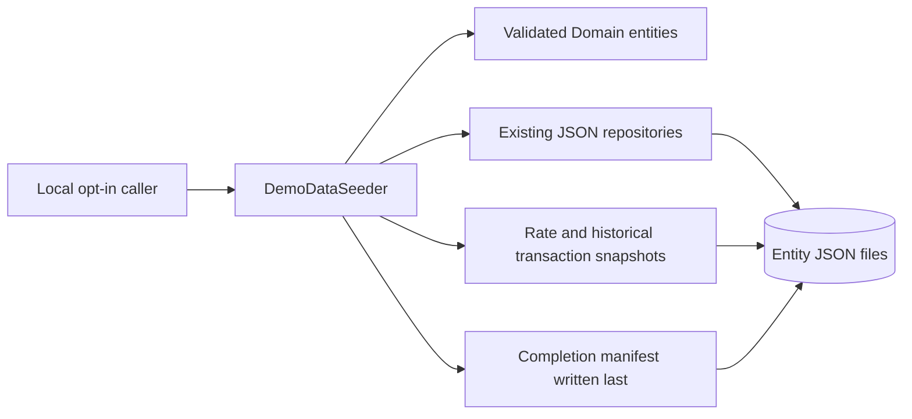

The seeder accepts only a nonexistent or empty configured data directory. It writes the fixed `apexpost-demo-v1` manifest last; a matching manifest makes a later call a no-op. If any unmarked data or an incompatible manifest exists, it fails without changing files. This protects user data but cannot make a failed multi-file initial seed atomic: a partial seed has no completion manifest and must be inspected or removed explicitly by the local operator before retrying. All identities are synthetic and no document references, passwords, or secrets are produced.

## Step 9 inventory application behavior

`InventoryService` owns inventory orchestration in Application. `BranchInventoryItem` remains the Domain owner of positive-change and non-negative-stock invariants. The narrowly extended `IInventoryRepository.UpdateAsync` contract runs one mutation against one branch/product item without exposing an intervening read/write window. `JsonInventoryRepository` implements it inside the existing `inventory.json` per-file lock.

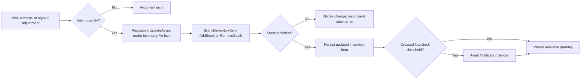

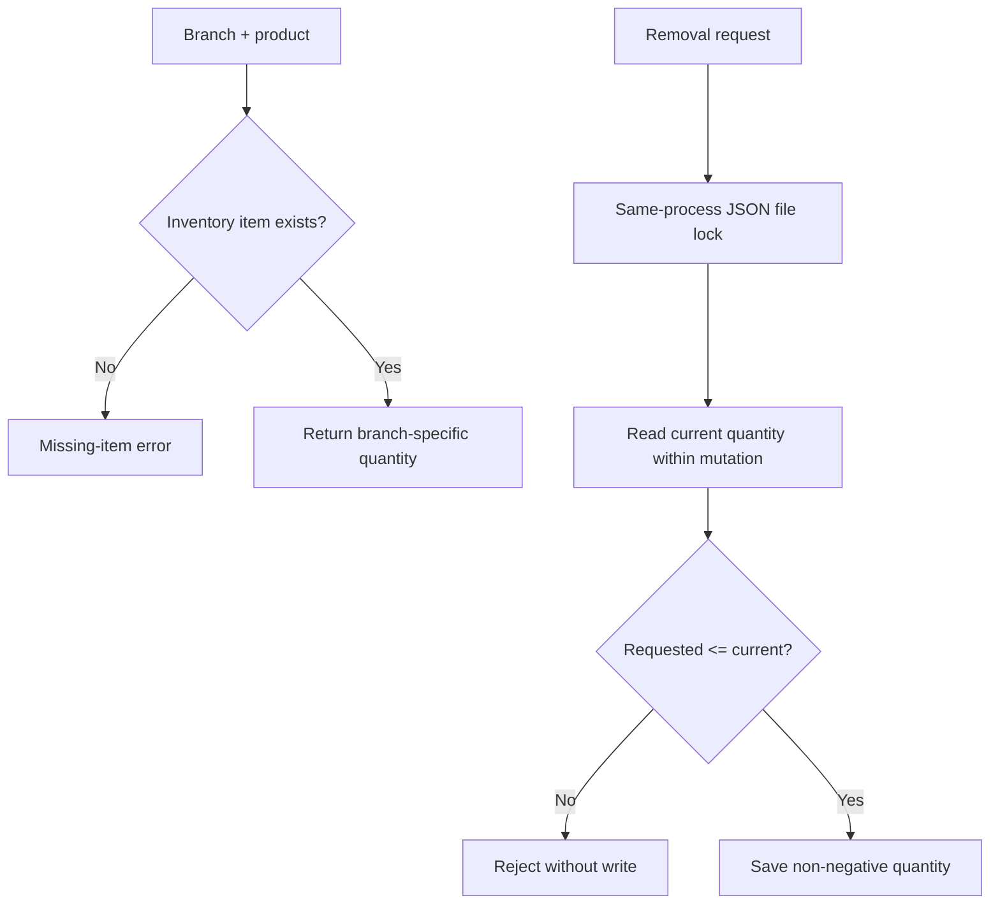

The JSON lock is process-wide and keyed by the inventory file path, so concurrent operations through JSON repository instances in one application process cannot oversell. It is not a cross-process lock and does not provide distributed transactions. Low-stock alerts are sent only on a downward threshold crossing and are awaited; without an outbox, a notification delivery failure can be reported after persistence, and delivery is not retried in this step.

## Step 10 shipping workflow

`ShippingWorkflowService` is an Application-layer coordinator. It translates raw request data into the existing validated Domain `Shipment` and value objects, checks the origin branch through `IBranchRepository`, obtains storage-agnostic configured rates through `IShippingRateProvider`, delegates all matching, fixed-price, and maximum-weight behavior to `ShippingPriceCalculator`, then saves through `IShipmentRepository`. `JsonShippingRateProvider` is the Infrastructure implementation that reads `shipping-rates.json` asynchronously.

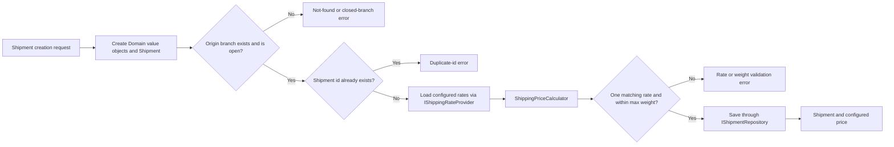

The workflow does not define rates, formulas, dimensional surcharges, or a universal service limit. `shipping-rates.json` configuration supplies one fixed charge and maximum weight for each applicable type/service/zone. The current Domain model requires positive dimensions for every shipment, including a letter, and no additional type-specific dimensions are invented. Persistence I/O errors propagate unchanged; missing origin branches and shipment retrieval use explicit Application exceptions. Courier integrations, labels, MVC, and transaction composition remain planned.

## Step 11 money orders and identity verification

`MoneyOrderWorkflowService` coordinates persistence and configured policy while `MoneyOrder` owns its amount, fee, sender, recipient, context identity, and verification-association invariants. `IMoneyOrderPolicy` provides `HighValueThreshold`; the application requires a supplied configuration value and does not hard-code a production threshold. An amount strictly greater than the threshold must have a successful `IdentityVerificationRecord` with the same `MoneyOrderContextId` before the repository save occurs.

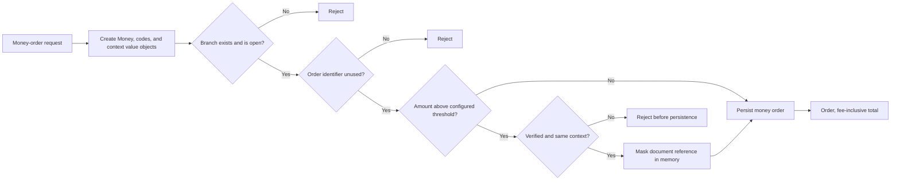

The raw identity-document number is transient request input only. Application converts it to `MaskedIdentityDocumentReference`; Domain and JSON persistence retain document type, verification outcome, transaction context, and only the masked representation. No external identity-provider call, audit filter, authentication, counter transaction, or MVC feature exists in this step. The policy threshold must be supplied by a future composition/configuration step, and currency/fee calculation policy remain intentionally unresolved.

## Step 12 mixed counter transactions

`CounterTransaction` is a Domain aggregate for branch/counter/clerk identity, immutable basket lines, subtotal, tax, payment method, and state. It allows `Open → Paid`, `Open → Voided`, and `Paid → Refunded`; manager authorization and reason input are validated at the Application boundary before the Domain transition. `CounterTransactionWorkflowService` validates branch, counter, clerk, existing money orders, stock, and configured tax policy. `ICounterTransactionRepository` is implemented by `JsonCounterTransactionRepository` in `counter-transactions.json`.

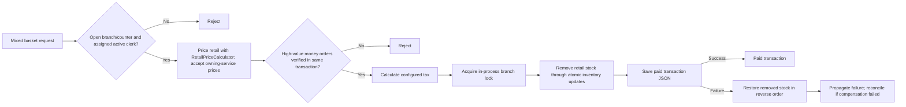

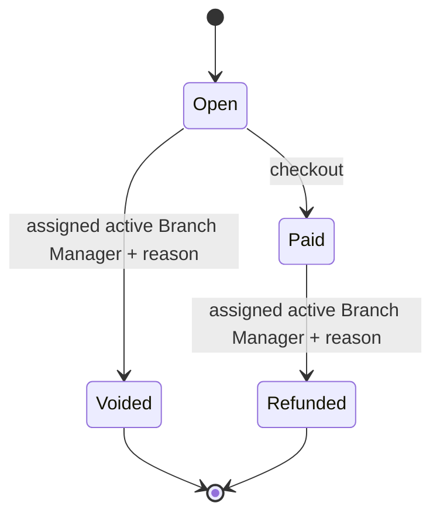

Multi-file JSON persistence is not atomic. The service uses an in-process branch lock to serialize its own mixed-basket workflows and the existing per-file inventory mutation lock to prevent overselling. Checkout removes stock before saving the transaction and compensates it if save fails; if a process ends between writes or a compensation write fails, reconciliation is required. Refund persists its status before restoring inventory and explicitly reports a restoration failure; voiding an open basket restores no stock because checkout only removes stock when it marks a transaction paid. These guarantees do not coordinate multiple application processes sharing JSON files, nor do they provide database-grade atomicity.

## Step 13 reports and simulated notifications

`BranchReportService` has four focused branch-scoped queries: paid daily sales split by retail/service plus tax, inventory at/below a caller-supplied threshold, shipment count grouped by destination zone/service level, and money-order verification outcome counts. The repository contracts add focused branch filters; no generic specification framework is introduced. Report reads are sequenced deliberately: each JSON repository uses its own same-process file lock, while `Task.WhenAll` would add little benefit and create a potentially inconsistent cross-file snapshot.

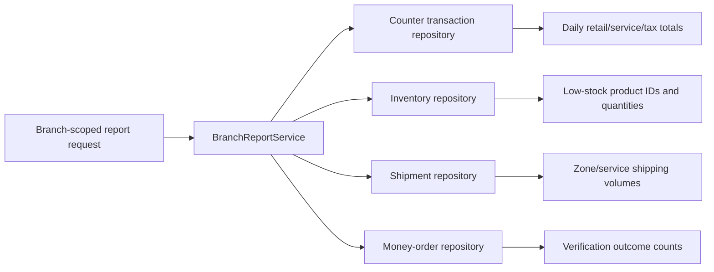

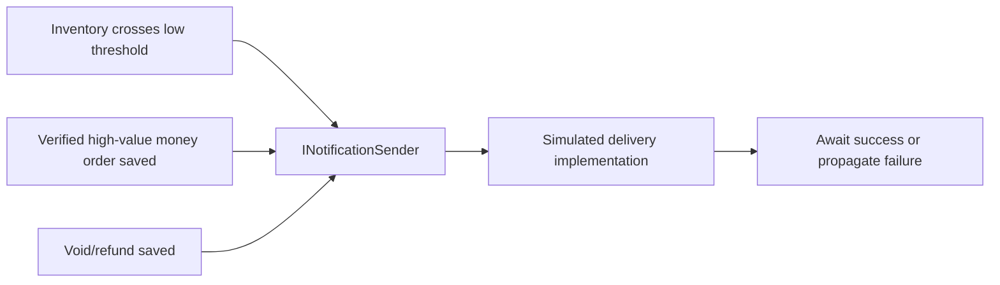

Notifications are observer-style calls through the existing Application abstraction, not an external provider. Each is sent after the relevant persistence succeeds; a delivery failure is observable to the caller but is not a distributed transaction and does not undo the stock/order/transaction state. Reports intentionally omit money-order sender, recipient, document type, and masked reference.

## Step 14 MVC request flow

```mermaid
flowchart LR
    Client[Browser] --> Routing[Conventional MVC routing]
    Routing --> Controller[Thin controller + view model validation]
    Controller --> AppService[Application workflow or report service]
    AppService --> Repository[Application repository abstraction]
    Repository --> Infrastructure[Infrastructure JSON implementation]
    Infrastructure --> Files[(Configured JSON files)]
    Controller --> Razor[Razor View / PRG redirect]
```

Controllers convert HTTP/view-model input into Application requests and return Views, redirects after successful POSTs, or relevant HTTP status results. They do not contain pricing, stock, verification, or persistence rules. Authentication/authorization is explicitly outside this step, despite the login UI placeholder.

## Step 15 authentication and authorization flow

```mermaid
flowchart TD
    Login[Login form + antiforgery token] --> Credentials[Local demo credential configuration]
    Credentials --> Staff[Load StaffMember from repository]
    Staff -->|Active| Claims[Issue HttpOnly cookie: StaffId, Role, BranchCode]
    Staff -->|Inactive / missing / invalid| Deny[Generic sign-in failure]
    Claims --> Request[Protected MVC request]
    Request --> Recheck[Reload staff record]
    Recheck -->|Active, role and branch unchanged| Policy[Role and SameBranchOnly policies]
    Recheck -->|Inactive or changed| Reject[Reject cookie and redirect to login]
    Policy --> Clerk[Counter Clerk own-branch workflows]
    Policy --> Manager[BranchManagerOnly void/refund + reason]
    Policy --> Reports[Auditor / Administrator / Manager own-branch reports]
```

Cookies are validated against the persisted staff record on every authenticated request. The application service remains the final authority for manager assignment, active staff status, transaction status transitions, and reversal reasons; endpoint policies reduce the HTTP attack surface but do not replace Domain/Application invariants.

```mermaid
flowchart TD
    Login[Login UI placeholder] --> Dashboard[Branch dashboard]
    Dashboard --> Catalogue[Catalogue and branch stock]
    Catalogue --> Basket[Counter basket]
    Dashboard --> Shipping[Create shipment]
    Shipping --> Label[Shipping-label preview]
    Dashboard --> Money[Money order + identity form]
    Dashboard --> Reports[Branch reports]
    Basket --> Receipt[POST then redirect]
    Money --> Receipt
```

## Test structure

Each test project references only the layer it tests: Domain Tests references Domain, Application Tests references Application, and Web Integration Tests references Web. The projects use xUnit; Web Integration Tests uses `Microsoft.AspNetCore.Mvc.Testing` to exercise MVC routes and form validation through a test host.

## Planned architectural components

Later steps may add application services and workflows, JSON persistence adapters, dependency-injection registrations, authentication and authorization, and MVC workflows. Domain entities, Application contracts, and pricing calculators are already implemented; concrete contract implementations are not.
