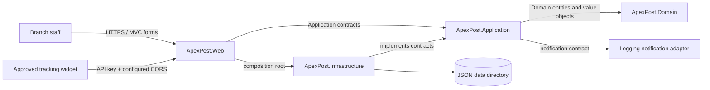
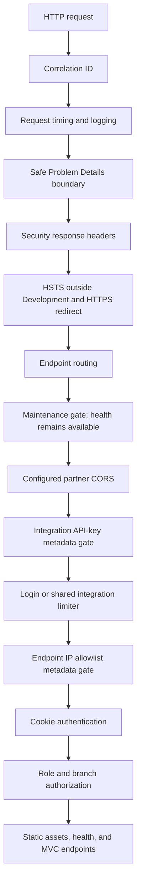

# ApexPost architecture

This directory is the entry point to the system architecture. It summarizes the
implemented runtime boundaries and links to the detailed component and workflow
design in [DESIGN.md](../../DESIGN.md). The diagrams describe the current
solution, not a proposed database-backed or distributed deployment.

## System context

ApexPost is a single ASP.NET Core MVC application for branch counter operations.
Staff use Razor views over HTTP; the Web host composes Application workflows
with Infrastructure adapters. JSON files in the configured data directory
provide persistence. No external identity, payment, shipping-carrier, or
notification service is called by the current implementation.



## Project boundaries

| Project | Owns | Must not own |
| --- | --- | --- |
| `ApexPost.Domain` | Entities, enums, value objects, and business invariants. | MVC, HTTP, JSON, or references to other solution projects. |
| `ApexPost.Application` | Use-case workflows, policies, repository/capability contracts, and coordination. | File paths, JSON serialization, or MVC types. |
| `ApexPost.Infrastructure` | JSON repositories/stores, rate configuration, audit persistence, and seed data. | Business decisions that belong to Domain or Application. |
| `ApexPost.Web` | MVC controllers/views, view models, authentication/authorization, filters, middleware, and composition. | The authoritative implementation of business invariants. |
| `ApexPost.*.Tests` | Layer-specific unit, adapter, and HTTP integration checks. | Production data, real credentials, or external service dependencies. |

Dependencies point inward for business code and outward only at the composition
boundary:


`ApexPost.Domain` has no solution-project references.

The four test projects are `ApexPost.Domain.Tests`,
`ApexPost.Application.Tests`, `ApexPost.Infrastructure.Tests`, and
`ApexPost.Web.IntegrationTests`. Each directly references only the production
project under test. See [the test architecture](../testing.md) for coverage and
commands.

## Runtime request and workflow path

`src/ApexPost.Web/Program.cs` is the composition root. It binds configuration,
registers JSON adapters and application services, configures MVC and security,
and assembles the HTTP pipeline; business rules remain in Domain/Application.

```mermaid
sequenceDiagram
    actor Clerk
    participant MVC as Web controller
    participant Workflow as Application workflow
    participant Domain as Domain model
    participant Repo as Application repository contract
    participant Json as Infrastructure JSON adapter
    Clerk->>MVC: Antiforgery-protected form post
    MVC->>Workflow: Typed request + current staff context
    Workflow->>Repo: Load required state
    Repo->>Json: Read/update JSON document
    Json-->>Repo: Domain data
    Workflow->>Domain: Apply invariants and calculate outcome
    Workflow->>Repo: Persist accepted state
    Repo->>Json: Atomic single-file replacement
    Workflow-->>MVC: Result or validation failure
    MVC-->>Clerk: Redirect on success; form feedback on failure
```

The diagram is the common boundary flow; use-case ordering differs. For example,
checkout validates independent branch/counter/staff/transaction reads, then
performs ordered inventory mutations and transaction persistence. If the later
transaction save fails, it attempts inventory compensation. This is not a
cross-file atomic transaction: process failure or failed compensation can
require reconciliation. See [transaction design](../../DESIGN.md#mixed-counter-transactions)
and [business-rule boundaries](../business-rules.md).

## HTTP pipeline and endpoint controls

The order below follows `Program.cs`. Ordering is security-significant: routing
selects endpoint metadata before metadata-aware API-key/IP controls, invalid
integration keys are rejected before they consume the shared rate limit, and
authentication precedes authorization.



IP restrictions use the direct connection address. A reverse-proxy deployment
must configure trusted forwarded headers and known proxies/networks before using
forwarded client addresses; arbitrary forwarding headers are not trusted by
default. The integration allowlist follows rate limiting, so a valid-key request
from a blocked address still consumes a permit. See
[security controls and operational boundaries](../security.md).

## Persistence, concurrency, and operational limits

- Repositories implement Application-owned contracts and persist JSON documents
  through a shared asynchronous file-store abstraction.
- Writes serialize to a same-directory temporary file and replace the target;
  per-path semaphores protect same-process read/modify/write operations.
- Cancellation is propagated for ordinary I/O. After a mutation has to be
  compensated, the immediate correction is allowed to complete independently of
  request cancellation.
- The locks do not coordinate multiple processes or hosts. Writes spanning
  multiple JSON files are not atomic, and no durable outbox/reconciliation worker
  is present.
- The audit store is append-only through its Application API, not tamper-proof;
  audit write failures are logged rather than changing an already completed
  business action.
- `src/ApexPost.Web/App_Data/` is runtime data (JSON stores, the JSON Lines
  audit log and the Data Protection key ring) and is ignored by Git.
- In Development the synthetic demo data set is seeded into an empty data
  folder at startup (ADR 0010); other environments never seed.

These are current implementation boundaries, not production guarantees. The
[JSON persistence ADR](../adr/0002-json-persistence-and-same-process-locking.md),
[audit ADR](../adr/0005-mvc-action-audit-with-json-store.md), and
[business rules](../business-rules.md) provide the rationale and detail.

## Performance and measurement

The implementation favors asynchronous I/O and uses `Task.WhenAll` only for
independent checkout validation reads. The shipping-rate table is cached in
memory and served through `ValueTask`, and the simulated courier lookup has a
timeout and a `SemaphoreSlim` concurrency limit. No benchmark harness or
representative load profile is included, so this documentation makes no
throughput or latency claim.
The MVC performance filter reports action duration against a configured warning
threshold; it is operational timing, not a benchmark. See
[concurrency and asynchronous behavior](../../DESIGN.md#concurrency-and-asynchronous-behavior)
and [test evidence](../testing.md).

## Architecture decision records

- [ADR 0001: Layered project dependencies](../adr/0001-layered-project-dependencies.md)
- [ADR 0002: JSON persistence and same-process locking](../adr/0002-json-persistence-and-same-process-locking.md)
- [ADR 0003: Local cookie authentication](../adr/0003-local-cookie-authentication.md)
- [ADR 0004: Security middleware ordering](../adr/0004-order-security-middleware-before-endpoints.md)
- [ADR 0005: MVC action audit with JSON store](../adr/0005-mvc-action-audit-with-json-store.md)
- [ADR 0006: Parallelize only independent checkout reads](../adr/0006-parallelize-only-independent-checkout-reads.md)
- [ADR 0007: Complete compensation after cancellation](../adr/0007-complete-compensation-after-cancellation.md)

For detailed entities, contracts, workflows, repository behavior, dependency
injection lifetimes, security design, and future work, continue to
[the full design document](../../DESIGN.md).
