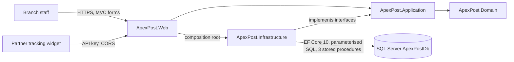

# ApexPost architecture

This page is a short entry point. The full design is in [DESIGN.md](../../DESIGN.md): layer and component diagrams, the ER diagram, data access patterns, the SOLID mapping and every ADR.

## System context

ApexPost is a single ASP.NET Core MVC application. Branch staff use Razor pages over HTTPS, and an approved partner widget calls one API endpoint with an API key. All business data and the audit trail live in one SQL Server database, `ApexPostDb`, accessed through EF Core 10. No external identity, payment, carrier or notification service is called: identity verification and courier tracking are simulated, and notifications are log entries.

## Project boundaries

| Project | Owns | Must not own |
|---|---|---|
| `ApexPost.Domain` | Entities, value objects, enums, invariants | Any reference to another project, EF Core or ASP.NET Core |
| `ApexPost.Application` | Use cases, policies, repository / unit-of-work / query / audit interfaces, read models | EF Core, SQL or MVC types |
| `ApexPost.Infrastructure` | `ApexPostDbContext`, configurations, migrations, repositories, unit of work, query services, procedure scripts, audit store, seeding | Business decisions |
| `ApexPost.Web` | Controllers, views, view models, filters, middleware, authentication, `Program.cs` | Business rules |

## Main runtime rules

- **Writes:** repositories stage changes, and the unit of work commits **once per use case** in one database transaction. Stock and sales use `rowversion` optimistic concurrency, so a conflict is a 409, never a lost update ([ADR 0015](../adr/0015-repository-and-unit-of-work-boundaries.md), [ADR 0017](../adr/0017-optimistic-concurrency-for-stock-and-transactions.md)).
- **Reads:** query services use no-tracking projections, one SQL statement per screen query, or the reporting stored procedures. There is one database; no separate read store.
- **Lifetimes:** one scoped `DbContext` per request, shared by that request's repositories and unit of work.
- **Audit:** `AuditResourceFilter` writes one record per MVC request with its own context, outside the request's unit of work ([ADR 0011](../adr/0011-audit-store-outside-the-unit-of-work.md)).
- **Schema changes:** reviewed EF Core migrations, plus a generated idempotent script. The application never creates or migrates the schema itself.

## HTTP pipeline

The middleware order is security-significant ([ADR 0004](../adr/0004-order-security-middleware-before-endpoints.md)):

1. correlation ID;
2. request logging;
3. the Problem Details boundary;
4. security headers;
5. HTTPS;
6. routing;
7. maintenance mode;
8. CORS;
9. API key;
10. rate limits;
11. IP allowlist;
12. cookie authentication;
13. authorisation;
14. endpoints.

The diagram is in [DESIGN.md](../../DESIGN.md#http-pipeline-and-security), and the controls are described in [security.md](../security.md).

## Further reading

- [PERFORMANCE.md](../../PERFORMANCE.md): indexes and execution plans.
- [sql/README.md](../../sql/README.md): T-SQL, blocking and deadlocks.
- [testing.md](../testing.md), [business-rules.md](../business-rules.md).
