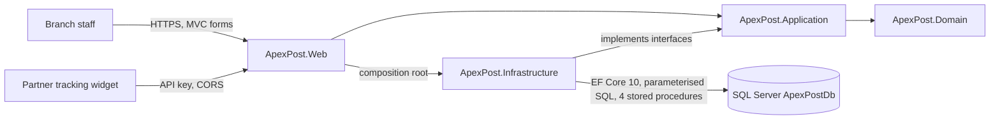
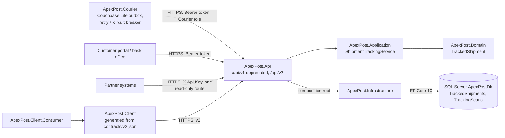

# ApexPost architecture

This page is a short entry point. The full design is in [DESIGN.md](../../DESIGN.md): layer and component diagrams, the ER diagram, data access patterns, the SOLID mapping and every ADR.

## System context

ApexPost is a single ASP.NET Core MVC application. Branch staff use Razor pages over HTTPS, and an approved partner widget calls one API endpoint with an API key. All business data and the audit trail live in one SQL Server database, `ApexPostDb`, accessed through EF Core 10. No external identity, payment, carrier or notification service is called: identity verification and courier tracking are simulated, and notifications are log entries.

## Project boundaries

| Project | Owns | Must not own |
|---|---|---|
| `ApexPost.Domain` | Entities, value objects, enums, invariants | Any reference to another project, EF Core or ASP.NET Core |
| `ApexPost.Application` | Use cases, policies, repository / unit-of-work / query / audit interfaces, read models | EF Core, SQL or MVC types |
| `ApexPost.Infrastructure` | `ApexPostDbContext`, configurations, migrations, repositories, unit of work, query services, procedure scripts, audit store, seeding | Business decisions |
| `ApexPost.Web` | Controllers, views, view models, filters, middleware, authentication, `Program.cs` | Business rules |
| `ApexPost.Courier.Offline` (Week 4) | The courier device's offline store. `Domain`: scans and contracts. `Storage`: Couchbase Lite database, repository, SQL++ queries, change listener. `Sync`: the outbox | Couchbase types in `Domain`; any reference to the Week 3 projects |
| `ApexPost.Courier.Offline.Harness` (Week 4) | Console menu over the offline store, with a fake server | Business rules |
| `ApexPost.Api` (Week 4) | The tracking REST API: • `Program.cs` (minimal hosting); • thin controllers per API version (`Controllers/V1`, `Controllers/V2`); • request and response DTOs (`Contracts`, `Contracts/V2`); • validation attributes; • the global exception handler; • versioning; • the OpenAPI transformers | Business rules; EF Core types; any entity in a request or response |
| `ApexPost.Client` (Week 4) | The typed C# client for API v2, generated by NSwag from `contracts/v2.json` (`Generated/`, never edited), plus hand-written partial classes and the `AddApexPostClient` registration | Any reference to the API or the Week 3 projects: it knows only the contract |
| `ApexPost.Client.Consumer` (Week 4) | A console program that uses the client as a partner would | Business rules |
| `ApexPost.Courier` (Week 4, Part D) | The courier's app, a console program on the Generic Host: • screens (`Screens`); • the typed `ApexApiClient`, `AuthHeaderHandler`, the resilience pipeline, source-generated JSON and the token store (`Api`); • the real uploader, automatic sync and network status (`Sync`) | A reference to the API project or the Week 3 projects: it knows the v2 contract only, through its own records |

The courier projects are a separate deployable for the courier's device. They share no code or database with the counter application; they reach ApexPost through the tracking API. See [OFFLINE-DESIGN.md](../../OFFLINE-DESIGN.md).

`ApexPost.Api` is a second host on the Week 3 layers and database. Its use cases are in `ApexPost.Application` (`ShipmentTrackingService`), its model in `ApexPost.Domain` (`TrackedShipment`, `TrackingScan`) and its persistence in `ApexPost.Infrastructure`. All of these are additions; nothing Week 3 uses was changed ([ADR 0025](../adr/0025-tracked-shipments-beside-counter-shipments.md)). See [API-NOTES.md](../../API-NOTES.md).

Its two versions, `/api/v1` (deprecated) and `/api/v2`, are separate controllers and response DTOs over the same service. Each version is described by its own OpenAPI document, committed under `contracts/`. `ApexPost.Client` is generated from the v2 contract, so it shares no code with the API ([ADR 0027](../adr/0027-url-segment-api-versioning-with-sunset.md), [ADR 0028](../adr/0028-openapi-contracts-and-generated-client.md), [VERSIONING.md](../../VERSIONING.md)).

Since Part D the API is secure by default ([ADR 0030](../adr/0030-api-security-tokens-roles-and-partner-keys.md), [SECURITY.md](../../SECURITY.md)). Every endpoint needs a JWT bearer token, and the roles decide what each caller may do. Partners read one route with an API key instead. `ApexPost.Courier`, the courier's app, uploads the offline scans through one resilient typed client ([ADR 0029](../adr/0029-courier-app-as-console-program.md), [ADR 0031](../adr/0031-courier-sync-through-one-resilient-client.md), [RESILIENCE.md](../../RESILIENCE.md)).

## Main runtime rules

- **Writes:** repositories stage changes, and the unit of work commits **once per use case** in one database transaction. Stock and sales use `rowversion` optimistic concurrency, so a conflict is a 409, never a lost update ([ADR 0015](../adr/0015-repository-and-unit-of-work-boundaries.md), [ADR 0017](../adr/0017-optimistic-concurrency-for-stock-and-transactions.md)).
- **Reads:** query services use no-tracking projections, one SQL statement per screen query, or the reporting stored procedures. There is one database; no separate read store.
- **Lifetimes:** one scoped `DbContext` per request, shared by that request's repositories and unit of work.
- **Audit:**
  - **Requests:** `AuditResourceFilter` writes one record per MVC request with its own context, outside the request's unit of work ([ADR 0011](../adr/0011-audit-store-outside-the-unit-of-work.md)).
  - **Data changes:** `DataChangeAuditInterceptor` records the old and new values of every changed row, in the same transaction as the change.
  - **Security events:** `SecurityEventRecorder` records sign-ins, sign-outs and refusals.
  - **Log and screen:** every record also goes to the `ApexPost.Audit` log category. The Audit log screen shows all three by role ([ADR 0024](../adr/0024-complete-audit-trail-and-audit-log-screen.md)).
- **Schema changes:** reviewed EF Core migrations, plus a generated idempotent script. The application never creates or migrates the schema itself.

## HTTP pipeline

The middleware order is security-significant ([ADR 0004](../adr/0004-order-security-middleware-before-endpoints.md)):

1. correlation ID;
2. request logging;
3. the Problem Details boundary;
4. security headers;
5. HTTPS;
6. routing;
7. maintenance mode;
8. CORS;
9. API key;
10. rate limits;
11. IP allowlist;
12. cookie authentication;
13. authorisation;
14. endpoints.

The diagram is in [DESIGN.md](../../DESIGN.md#http-pipeline-and-security), and the controls are described in [security.md](../security.md).

The tracking API (`ApexPost.Api`) has its own, shorter pipeline:
1. the exception handler (ProblemDetails);
2. HSTS (outside Development);
3. status-code pages;
4. HTTPS redirection;
5. the rewrite of the unversioned Part B URLs to v1;
6. routing;
7. the OpenAPI documents and Swagger UI (Development only);
8. authentication (JWT bearer);
9. authorisation (the fallback policy and the roles);
10. endpoints, where the courierId filter and the partner API key filter run before their actions.

Authentication comes after Swagger UI, because the fallback policy also covers requests that match no endpoint, and the page where a developer enters a token cannot itself require one ([SECURITY.md](../../SECURITY.md)).

## Further reading

- [SECURITY.md](../../SECURITY.md) and [RESILIENCE.md](../../RESILIENCE.md): the tracking API's security and the courier app's resilience.
- [PERFORMANCE.md](../../PERFORMANCE.md): indexes and execution plans.
- [sql/README.md](../../sql/README.md): T-SQL, blocking and deadlocks.
- [testing.md](../testing.md), [business-rules.md](../business-rules.md).
